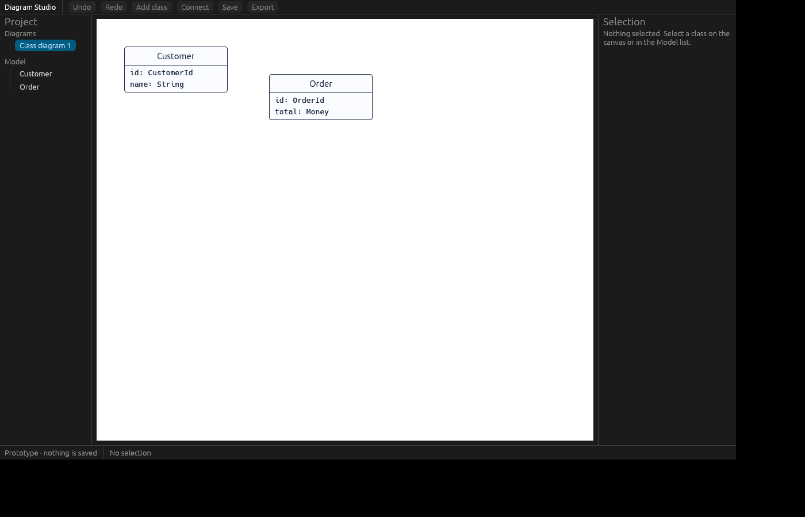

# R0-02 / R0-03 — native shell and bundled SQLite

Verified on 2026-11-04 on **Linux x64** (cloud container, Rust 1.99.1). **Both tasks are in progress, not done.** Their acceptance requires Windows: R0-02 must launch debug and release builds on Windows, and R0-03 must compile the bundled SQLite with MSVC. The Windows rows below are still to be filled in.

## Delivered

**R0-02 — native egui shell** (`crates/diagram-desktop`)

- eframe 0.37.0 with the wgpu renderer (ADR-001). Window 1280×800, minimum 800×500.
- Layout from [03-GUI-AND-WORKFLOWS.md](../../plan-rust-diagram-editor/03-GUI-AND-WORKFLOWS.md): toolbar, resizable project sidebar (220) and inspector (280), white canvas, status bar.
- Two prototype classes (`Customer`, `Order`). Select by clicking on the canvas or in the sidebar Model list (the keyboard and screen-reader alternative). Click empty canvas or press Escape to deselect. Escape inside the name field first leaves the field; a second Escape deselects.
- Selection is shown by a thicker border **and** corner handles, not by colour alone.
- Inspector edits the name with a real `TextEdit` labelled "Name". A blank name shows a text warning, and the canvas and lists show "Unnamed class".
- Toolbar actions that do not exist yet (Undo, Redo, Add class, Connect, Save, Export) are disabled, with a hover explanation.
- Each canvas class is exposed to AccessKit as "Class <name>", with its selected state.
- Diagnostics: if the window or graphics adapter cannot start, the program prints `Diagram Studio could not start: <error>`, the cause chain and a hint specific to the failure, then exits with code 1. Platform libraries that panic instead of returning an error get an explanatory line before the panic report. `--version` prints the app and bundled SQLite versions without opening a window; unknown arguments print usage and exit 2.
- The preview classes are prototype data owned by the desktop crate. They are not the M1 core model.

**R0-03 — bundled SQLite** (`crates/diagram-storage`)

- rusqlite 0.41.1 with `bundled` (libsqlite3-sys 0.39.1, SQLite 3.54.1 compiled from source).
- `diagram_storage::sqlite_version()` feeds `--version` diagnostics. No schema or file format is defined yet; that is M1.

## Results (Linux)

| Check | Observed result |
|---|---|
| `cargo fmt --all -- --check` | Passed |
| `cargo clippy --workspace --all-targets --all-features --locked -- -D warnings` | Passed, no warnings |
| `cargo test --workspace --locked` | 30 integration tests + 1 doc test passed (core 9, desktop shell 11, desktop diagnostics 8, storage 2) |
| `cargo doc --workspace --no-deps --locked` | Generated, no warnings |
| `cargo build -p diagram-desktop --release --locked` | Built |
| Release launch under Xvfb with Mesa lavapipe (software Vulkan) | Window rendered through wgpu and kept running until stopped; screenshot below |
| Launch with no display | Exit 1, "could not start" message with DISPLAY hint, no panic (automated test) |
| Launch with `libxkbcommon-x11` hidden | winit panics inside eframe; the explanatory line is printed first (manual check) |
| `ldd target/release/diagram-desktop` | No `libsqlite3` dependency |
| `cargo tree -i libsqlite3-sys -e features` | `bundled` enabled through `diagram-storage` only |
| `cargo tree -p diagram-core` | thiserror only; core stays free of GUI and SQL |
| SQLite smoke test | Writes Latin and Arabic text, closes, reopens read-only, `integrity_check` = ok, rows equal, no journal/WAL left, file deleted (proves handles released) |

The default egui theme follows the system preference (dark in this container). The planned light-first theme is not set yet.

## Results (Windows) — to record

| Check | Observed result |
|---|---|
| `scripts/check.ps1` (MSVC, includes bundled SQLite C compile) | Not yet run |
| `cargo run -p diagram-desktop --locked` (debug window opens, selection and rename work) | Not yet run |
| `target\release\diagram-desktop.exe` launch | Not yet run |
| `diagram-desktop.exe --version` | Not yet run |
| `dumpbin /dependents target\release\diagram-desktop.exe` shows no `sqlite3.dll` | Not yet run |

When these pass, set R0-02 and R0-03 to `done` in [roadmap.json](../../plan-rust-diagram-editor/roadmap.json) with this file as evidence and run `python build_rust_roadmap.py`.

## Findings during implementation

- The headless test harness has no Arabic glyphs or `⚠`, and egui_kittest panics on a missing glyph by default. The release app draws an empty box instead and uses eframe's system-font fallback. Arabic shaping and fonts are R0-04 work; the warning now uses plain text ("Warning:").
- egui drops text focus at the start of the frame in which Escape is pressed. The shell therefore remembers focus from the previous frame, so Escape in the name field does not also clear the selection.
- On Linux, `libxkbcommon-x11` and a Vulkan or GL driver are required at run time. Windows needs neither.

## Remaining gates

R0-04 (English/Arabic/mixed text, IME, keyboard, screen readers, 100/150/200% scaling) and R0-05 (gate review and ADR-001 update) need a real Windows desktop and are not started.
