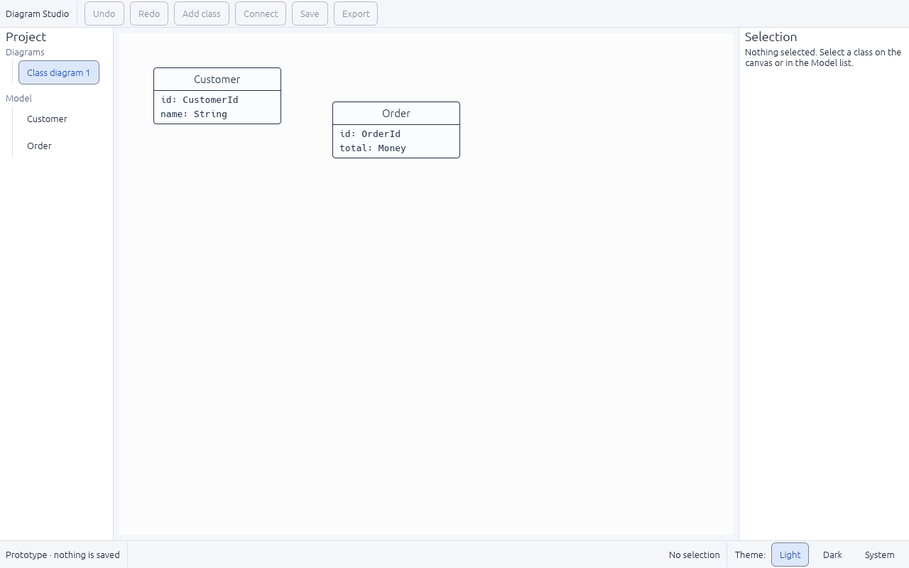
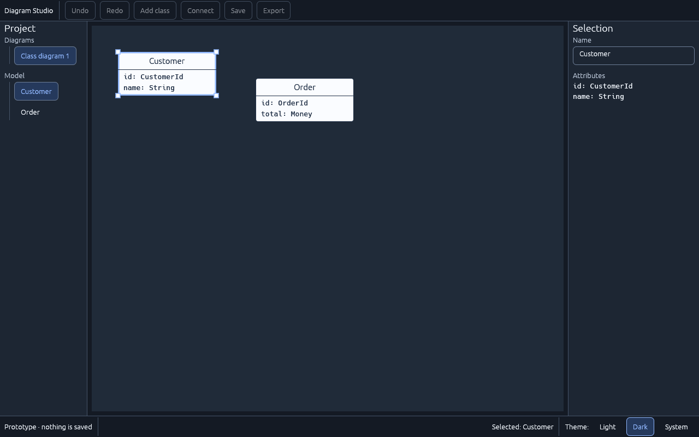

# Diagram Studio — UI work: what is done and what is next

This page is for anyone following the project. It summarises the user-interface work, links the evidence for each finished task, and lists what comes next. The full specification is the [UI plan](../../../plan-rust-diagram-editor/UI-DESIGN-AND-INTEGRATION.md). Task status lives in the [roadmap tracker](../../../plan-rust-diagram-editor/roadmap.json), and the [dashboard](../../../plan-rust-diagram-editor/ROADMAP.html) shows it.

## Where the project stands

- **Working today:** a native Windows/Linux desktop window (egui) with a toolbar, project sidebar, canvas with two sample classes, inspector and status bar. You can select a class and rename it, search commands and classes with Ctrl+K, and switch between light and dark themes instantly.
- **Not built yet:** the real project model, adding or connecting classes, undo, saving and export. Those buttons are visible but disabled, with an explanation.
- **Order of work:** finish the native foundation gate (M0) → design every screen as native fixtures (UX milestone, UI-01 to UI-12) → build the model and storage (M1) → connect the screens to the model (M2) → reliability and the v0.1 release (M3).

## UI task status

| Task | What it delivers | Status |
|---|---|---|
| UI-01 | Design tokens and base components | In progress — [evidence](UI-01-TOKENS-AND-COMPONENTS.md); showcase and state checks remain |
| UI-02 | Type scale, text roles and font files | In progress — [evidence](UI-02-TYPE-SCALE-AND-TEXT-ROLES.md); reviewed font files remain |
| UI-03 | Responsive workspace | Built and checked — [evidence](UI-03-RESPONSIVE-WORKSPACE.md); done once UI-01 is done |
| UI-04 | Welcome, new-project and open screens | Next |
| UI-05 | Navigator and diagram tabs | Not started |
| UI-06 | Tool and command catalog | In progress — [evidence](UI-06-COMMAND-CATALOG.md); typed intents and action contracts remain |
| UI-07 | Canvas state presentations | Not started |
| UI-08 | Contextual inspector | Not started |
| UI-09 | Dialogs, status bar and validation drawer | Not started |
| UI-10 | Keyboard, focus and accessibility checks | Not started |
| UI-11 | Notation capability contract | Not started (needs UI-06 and UI-08) |
| UI-12 | Native UI review gate | Not started |
| UI-13 – UI-17 | Bind the screens to the real model (M2) | Not started |
| UI-18 | Final visual, accessibility, recovery and export review (M3) | Not started |

## What has been done

### UI-01 — Design tokens and base components
- One set of named colours for light and dark themes, instead of colours scattered through the code. Every text and control colour is measured against its background and meets the accessibility targets (4.5:1 for text, 3:1 for control borders).
- **Problem found and fixed:** the border colour in the plan was too faint for buttons and fields. It measured 1.2–2.3:1, where 3:1 is needed. New border colours pass in both themes.
- Reusable components (titles, labels, labeled fields, list rows, buttons that explain why they are disabled, warnings in words rather than colour alone). The shell uses only these.
- Theme choice (Light, Dark, System) in the status bar, applied instantly. Diagrams keep their own colours, so switching theme never changes how a diagram looks or exports.
- 8 new automated tests check the colours and the theme switch.

| Light | Dark |
|---|---|
|  |  |

### UI-02 — Type scale and text roles
- Five text roles define every text size in one place: page title 24, panel title 16, body 15, labels 14, code 14 (monospace).
- Rules for text direction are written down. Showing Arabic and mixed Arabic/English text in the right order stays **open** until the R0-04 check, because the GUI library cannot reorder right-to-left text yet.
- **Two problems found and fixed** by testing a 70-character class name in the smallest window (800×500): list rows wrapped onto several lines, and the name spilled out of its box on the canvas. Both now shorten with "…", and screen readers still hear the full name.
- 9 new automated tests check sizes and that nothing overlaps or leaves the window at 800×500, 1280×800 and 1440×900.


### UI-06 — Tool and command catalog
- One list of commands now feeds the toolbar, the future menus, keyboard shortcuts and a new **command search** (Ctrl+K or the **Search** button), so they can't drift apart. Every unavailable command says why, for example "Not available yet: this prototype cannot save."
- Typing in a text field keeps its own keys: Ctrl+Z undoes typing and Escape leaves the field. They don't trigger app commands.
- The search finds commands and classes; Enter runs the highlighted result and Escape closes it.
- **Two problems found and fixed:** keyboard focus did not return to where you were after closing the search, and Enter did nothing because the highlight started on an unavailable command.
- 17 new automated tests.


### UI-03 — Responsive workspace
- The full window layout from the design: a header with a **Menu** (every command, grouped, with shortcuts), Undo/Redo, Search, Save and Export; a tab row; a tool row with Select, Pan, Class, Association, Note and Arrange; the project panel and inspector at their planned widths.
- **Small windows:** below 1020 points wide, the panels become drawers over the canvas, opened by the **Project panel** and **Inspector** buttons. **Escape** closes a drawer and returns keyboard focus to the button that opened it. A panel you hide stays hidden when the window is resized.
- **Two problems found and fixed:** Escape was swallowed whenever *any* button had keyboard focus, so keyboard users couldn't close a drawer or clear the selection; and unpressed toggle buttons had no border, so they looked like plain text.
- 15 new automated tests; all 15 header and row controls fit without overlapping from 800×500 to 1440×900.

| Docked, 1280×800 | Small window with the inspector drawer |
|---|---|
|  |  |

## What is next
1. **UI-04 — welcome, new-project and open screens.**
2. **UI-11 — notation capability contract** needs UI-08 (the inspector) first, in the tracker's order.
3. **In parallel (needs a Windows desktop):** R0-04 text and accessibility matrix — Arabic and mixed text, IME, Narrator/NVDA and 100/150/200% scaling — then the R0-05 framework decision.

## How to try it
From `app/`:

```sh
cargo run -p diagram-desktop --locked
```

Click a class or a name in the Model list, rename it in the inspector, press Ctrl+K to search commands and classes, and switch Light / Dark / System in the bottom-right corner. Run all checks with `scripts/check.ps1` on Windows, or the commands in the [workspace README](../../README.md).
