# Diagram Studio — UI work: what is done and what is next

This page is for anyone following the project. It summarises the user-interface work, links the evidence for each finished task, and lists what comes next. The full specification is the [UI plan](../../../plan-rust-diagram-editor/UI-DESIGN-AND-INTEGRATION.md). Task status lives in the [roadmap tracker](../../../plan-rust-diagram-editor/roadmap.json), and the [dashboard](../../../plan-rust-diagram-editor/ROADMAP.html) shows it.

## New design reference

The [new design documentation](new-design/README.md) contains the complete proposed functionality, Rust implementation responsibilities, keyboard shortcuts, FigJam review and research. Start with the [functional specification](new-design/NEW-DESIGN-FUNCTIONAL-SPEC.md). Proposed features and shortcuts require implementation; the evidence below describes current behavior.

## How UI work is checked

Every UI change follows the [UI rules](../../../plan-rust-diagram-editor/UI-RULES.md): visible labels, keyboard access, reasons for disabled controls, errors in words, measured contrast, and layouts checked at 800×500 to 1440×900. An automated **usability audit** (`tests/ui_audit.rs`) checks every screen for unnamed controls, controls too small to hit, overlapping or off-window controls, and controls Tab cannot reach. A self-test proves the audit catches each of these. Code structure follows the [maintainability skill](../../../.claude/skills/diagram-studio-maintainability/SKILL.md), whose check script measures the structural rules on every change.

## Where the project stands

- **Working today:** a native Windows/Linux desktop window (egui) bound to the real `diagram-core` document. The window opens on a welcome screen where you can start a new, empty project or the sample project. In a project you can:
  - select classes and relationships, and rename classes;
  - edit role names and multiplicities, with errors in words;
  - use Undo and Redo (Ctrl+Z, Ctrl+Shift+Z);
  - open several diagram tabs and search with Ctrl+K;
  - close the project, with a prompt when changes would be lost;
  - open the panels as drawers on small windows and switch between light and dark.

  The storage engine (save, load, recovery) is built and tested on its branch but not yet wired to the window.
- **Not built yet:** adding or connecting classes on the canvas, member editing, drag, Save and Open in the window, and export. Those buttons are visible but disabled, with an explanation. Slice-by-slice progress: [BUILD-PROGRAM.md](../next-steps/BUILD-PROGRAM.md#where-the-build-stands-2026-11-06).
- **Last full check:** [progress test, 2026-11-06](progress-test-2026-11-06.md). 287 tests pass and the hand test passes 13 of 16 rows. The 3 rows that fail go to bug slice B1.
- **Order of work:** three streams run in parallel: the remaining native foundation checks (M0), designing every screen as native fixtures (UX milestone, UI-01 to UI-12), and building the model and storage (M1, which needs only the R0-01 workspace). All three gate connecting the screens to the model (M2), then reliability and the v0.1 release (M3).

## UI task status

Generated from the [roadmap tracker](../../../plan-rust-diagram-editor/roadmap.json); edit the tracker, not this table. Remaining work for a task in progress is listed in its evidence page.

<!-- roadmap:ui-tasks:begin (generated from roadmap.json by build_rust_roadmap.py; edit roadmap.json instead) -->
| Task | What it delivers | Status |
|---|---|---|
| UI-01 | Implement design tokens and reusable controls | **Done** — [evidence](UI-01-TOKENS-AND-COMPONENTS.md) |
| UI-02 | Specify and prove typography and font assets | In progress — [evidence](UI-02-TYPE-SCALE-AND-TEXT-ROLES.md) |
| UI-03 | Build the responsive workspace composition | **Done** — [evidence](UI-03-RESPONSIVE-WORKSPACE.md) |
| UI-04 | Design welcome and project entry screens | **Done** — [evidence](UI-04-WELCOME-AND-ENTRY.md) |
| UI-05 | Build navigator and diagram-tab presentation | **Done** — [evidence](UI-05-NAVIGATOR-AND-TABS.md) |
| UI-06 | Unify command catalog and tool availability | **Done** — [evidence](UI-06-COMMAND-CATALOG.md) |
| UI-07 | Present every canvas interaction state | Not started |
| UI-08 | Build contextual inspector presentation | **Done** — [evidence](UI-08-CONTEXTUAL-INSPECTOR.md) |
| UI-09 | Design dialogs, validation and asynchronous status | Not started |
| UI-10 | Verify designed keyboard and accessible layouts | Not started |
| UI-11 | Define notation capability and surface contract | **Done** — [evidence](UI-11-NOTATION-CONTRACT.md) |
| UI-12 | Pass the complete native UI design review | Not started |
| UI-13 | Bind project lifecycle and navigation to sessions | Not started |
| UI-14 | Bind inspector and member edits to commands | Not started |
| UI-15 | Bind canvas tools and history to real document | Not started |
| UI-16 | Bind real save and validation status to worker results | Not started |
| UI-17 | Pass the integrated keyboard editing journey | Not started |
| UI-18 | Pass final UI, export and recovery review | Not started |
<!-- roadmap:ui-tasks:end -->

## What has been done

### UI-01 — Design tokens and base components
- One set of named colours for light and dark themes, instead of colours scattered through the code. Every text and control colour is measured against its background and meets the accessibility targets (4.5:1 for text, 3:1 for control borders).
- **Problem found and fixed:** the border colour in the plan was too faint for buttons and fields. It measured 1.2–2.3:1, where 3:1 is needed. New border colours pass in both themes.
- Reusable components (titles, labels, labeled fields, list rows, buttons that explain why they are disabled, warnings in words rather than colour alone). The shell uses only these.
- Theme choice (Light, Dark, System) in the status bar, applied instantly. Diagrams keep their own colours, so switching theme never changes how a diagram looks or exports.
- 8 new automated tests check the colours and the theme switch.

| Light | Dark |
|---|---|
|  |  |

- **Completed later:** focus, error and disabled states are measured in both themes, fields can show an error (red border plus an "Error:" message), and a **component showcase** (Menu → View → Component showcase, or Ctrl+K "showcase") displays every control in every state as a labeled design fixture.

| Component showcase, light | Dark |
|---|---|
| 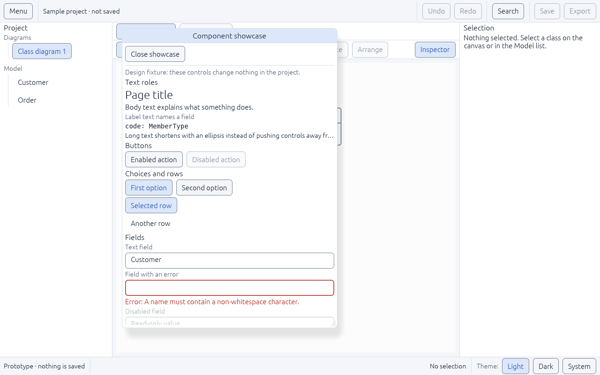 | 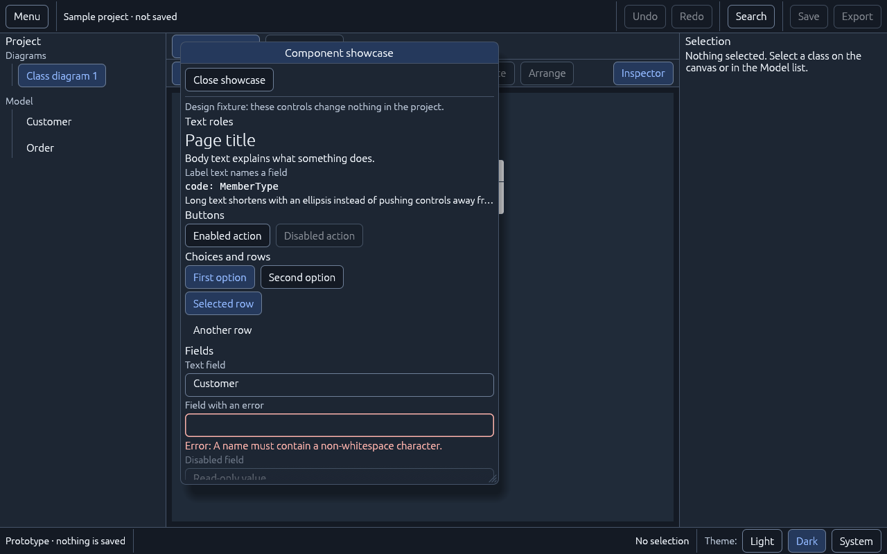 |

### UI-02 — Type scale and text roles
- Five text roles define every text size in one place: page title 24, panel title 16, body 15, labels 14, code 14 (monospace).
- Rules for text direction are written down. Showing Arabic and mixed Arabic/English text in the right order stays **open** until the R0-04 check, because the GUI library cannot reorder right-to-left text yet.
- **Two problems found and fixed** by testing a 70-character class name in the smallest window (800×500): list rows wrapped onto several lines, and the name spilled out of its box on the canvas. Both now shorten with "…", and screen readers still hear the full name.
- 9 new automated tests check sizes and that nothing overlaps or leaves the window at 800×500, 1280×800 and 1440×900.

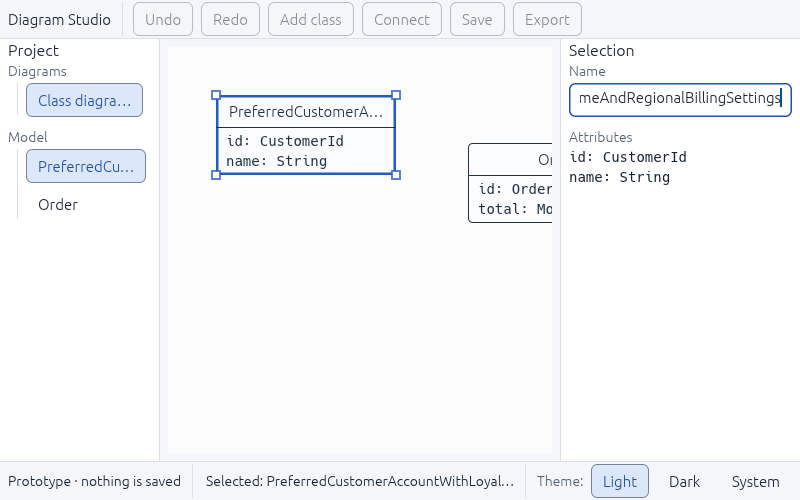

### UI-06 — Tool and command catalog
- One list of commands now feeds the toolbar, the future menus, keyboard shortcuts and a new **command search** (Ctrl+K or the **Search** button), so they can't drift apart. Every unavailable command says why, for example "Not available yet: this prototype cannot save."
- Typing in a text field keeps its own keys: Ctrl+Z undoes typing and Escape leaves the field. They don't trigger app commands.
- The search finds commands and classes; Enter runs the highlighted result and Escape closes it.
- **Two problems found and fixed:** keyboard focus did not return to where you were after closing the search, and Enter did nothing because the highlight started on an unavailable command.
- 17 new automated tests.

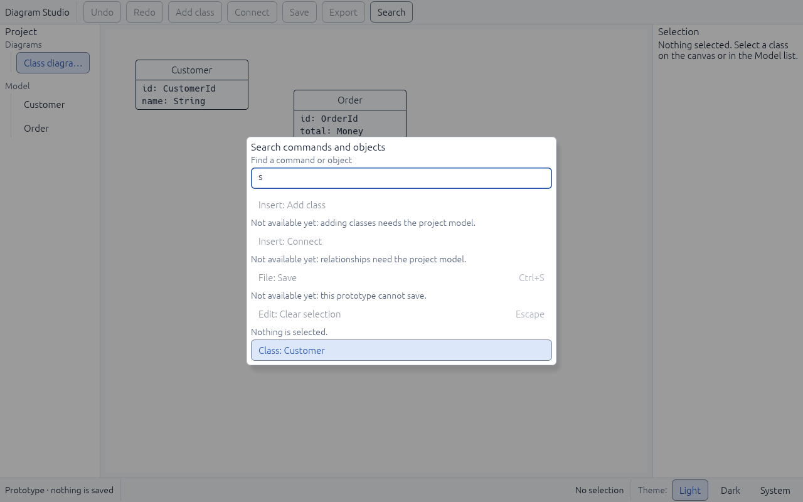

### UI-03 — Responsive workspace
- The full window layout from the design: a header with a **Menu** (every command, grouped, with shortcuts), Undo/Redo, Search, Save and Export; a tab row; a tool row with Select, Pan, Class, Association, Note and Arrange; the project panel and inspector at their planned widths.
- **Small windows:** below 1020 points wide, the panels become drawers over the canvas, opened by the **Project panel** and **Inspector** buttons. **Escape** closes a drawer and returns keyboard focus to the button that opened it. A panel you hide stays hidden when the window is resized.
- **Two problems found and fixed:** Escape was swallowed whenever *any* button had keyboard focus, so keyboard users couldn't close a drawer or clear the selection; and unpressed toggle buttons had no border, so they looked like plain text.
- 15 new automated tests; all 15 header and row controls fit without overlapping from 800×500 to 1440×900.

| Docked, 1280×800 | Small window with the inspector drawer |
|---|---|
| 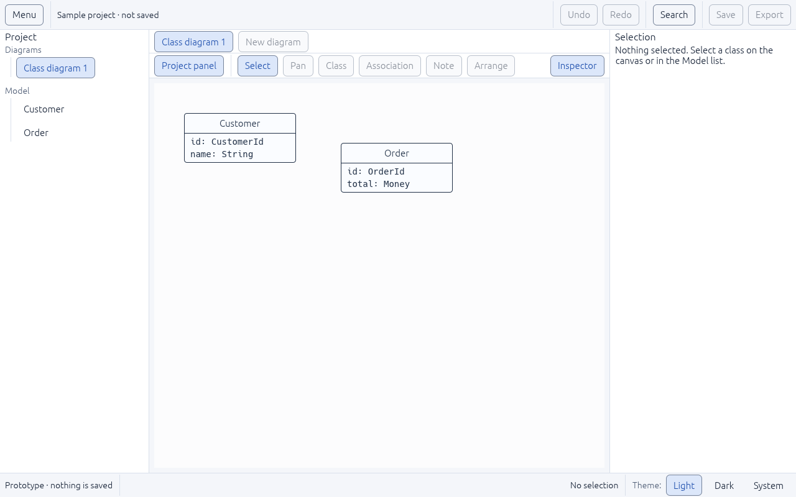 | 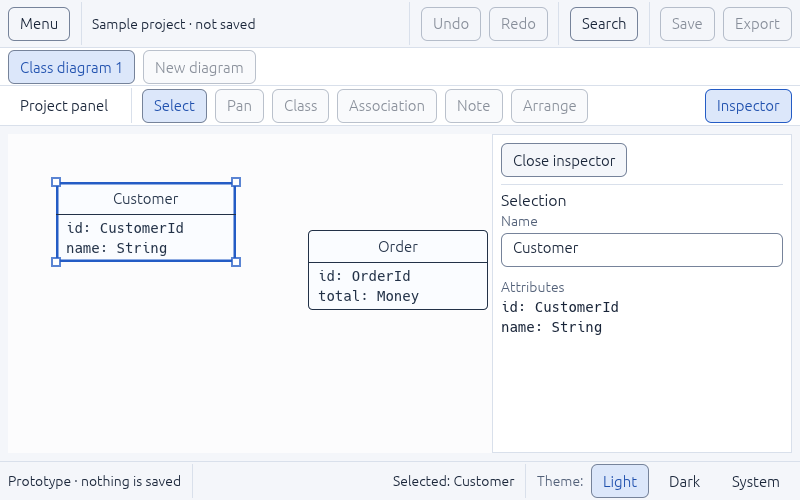 |

### UI-04 — Welcome and project entry screens
- The app now opens on a **welcome screen**: New project, Open project (disabled until project storage exists, and it says so), Continue with the sample project, a searchable list of recent projects and a recovery notice. Both the list and the notice are clearly labeled as sample entries.
- **New project** asks for a name, checked by the same rule the core uses. A blank name shows the error right beside the field. **Create** opens an empty diagram with that exact name; **Cancel** or Escape goes back.
- **Four problems found and fixed:** the app would have **crashed on start** (a text style was missing on the very first frame); the name field **lost keyboard focus** as soon as its error appeared; the recovery notice looked like a real recovery; and "No selection" showed on the welcome screen.
- 17 new automated tests.

| Welcome | Invalid name | Created project |
|---|---|---|
| 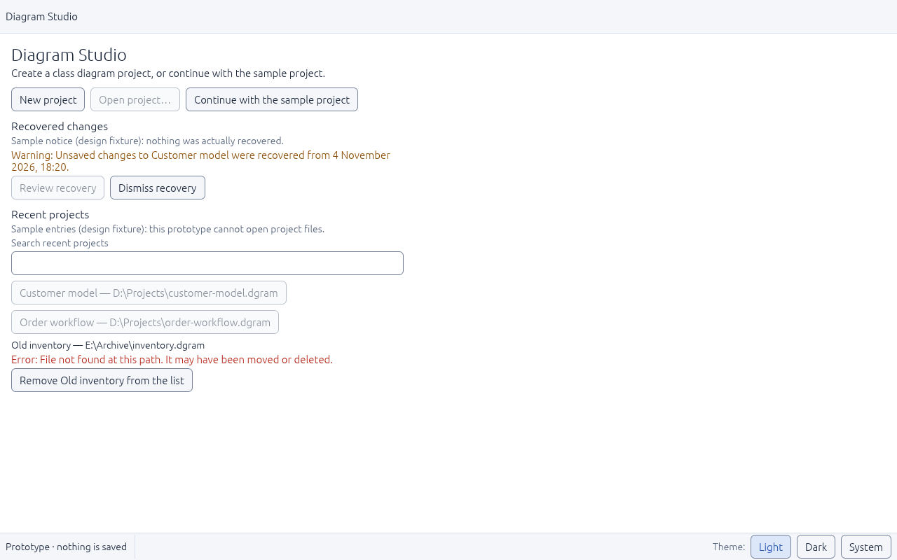 | 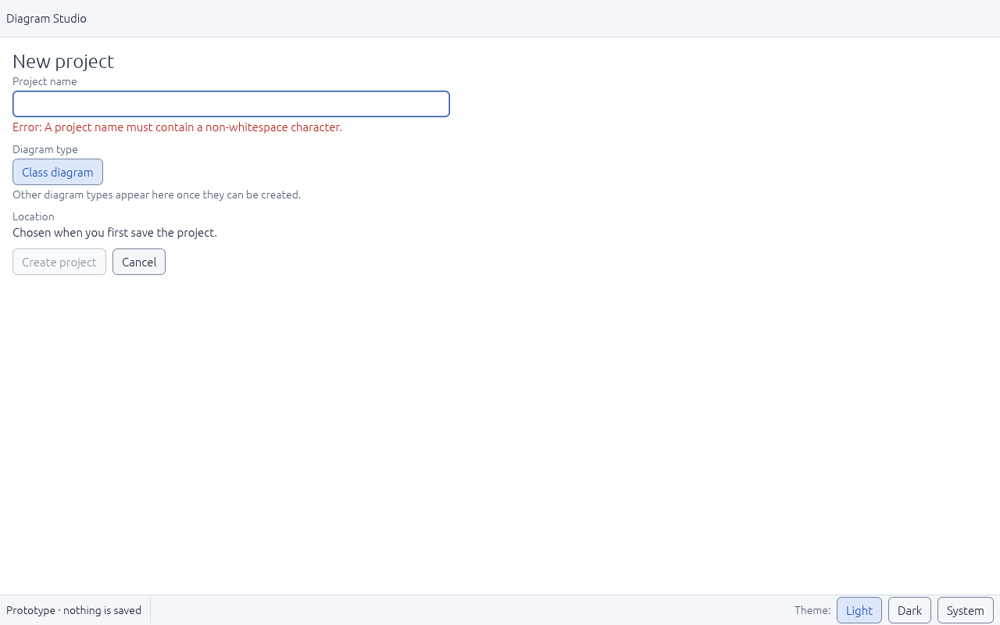 | 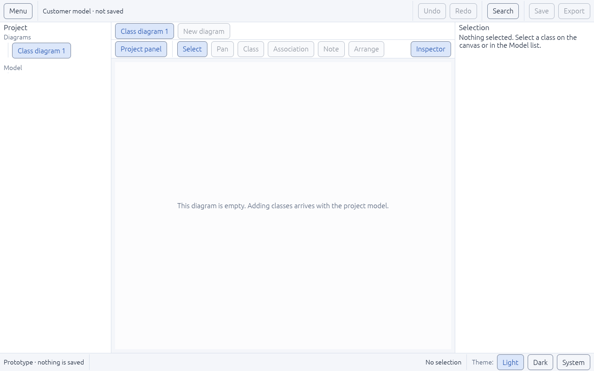 |

### UI-05 — Project panel and diagram tabs
- The project panel has a **search** and two sections: **Diagrams** (views of the model) and **Model** (classes shared by all diagrams). Each section says clearly when it is empty or when nothing matches.
- Picking a class that isn't on the current diagram **opens a diagram that shows it**. The inspector says which diagrams show the class, so it's clear that renaming changes it everywhere.
- **Tabs:** one per open diagram, each with a labeled Close button. Each tab remembers its own selection; closing a tab never deletes anything. Tabs that don't fit go into a **More tabs** menu.
- 15 new automated tests, plus new usability-audit scenes.

| Two tabs, dark theme | Search with no matches |
|---|---|
| 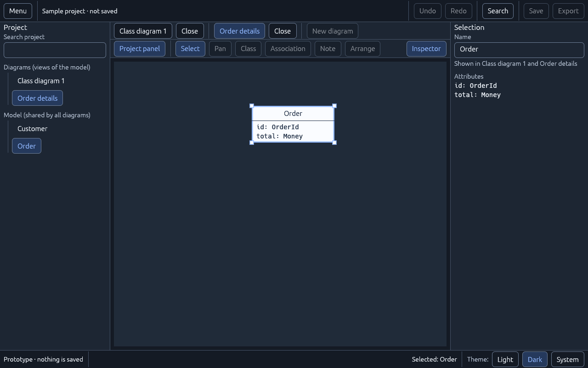 | 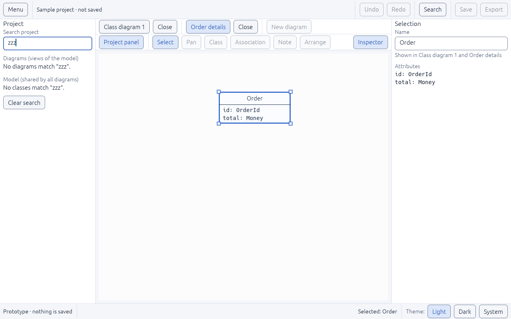 |

- **Completed later (UI-06):** buttons, menus, tabs and lists no longer change anything directly. They send typed **intents** that one coordinator applies, which keeps behaviour consistent and testable. Every command also has a written **contract**: what it needs, what it changes, who carries it out and how it interacts with undo, plus the test that covers it. A test fails if any contract points to a test that doesn't exist.

### UI-08 — Contextual inspector
- Editing in the inspector is now **safe**: a change is a draft until you press **Enter** (or move to another field), **Escape** cancels it, and an invalid value stays in the field with its error instead of being saved.
- The inspector adapts to what's selected: the **diagram** when nothing is selected; a **class** with its members, collapsed Appearance and Advanced sections; **several classes**, showing which values differ and refusing edits that would silently apply to all; or a **relationship**, with each end's role and multiplicity (checked: `1`, `0..*`, `2..5` and so on).
- **Ctrl+click** adds classes to the selection; the sample now has a relationship ("Customer places Order") drawn on the canvas.
- **Five problems found and fixed**, including the name field changing the class on every keystroke, an arrow symbol missing from the font, and relationship labels drawn on top of each other.
- 14 new automated tests and new usability-audit scenes.

| Relationship (dark) | Several classes | Invalid name |
|---|---|---|
| 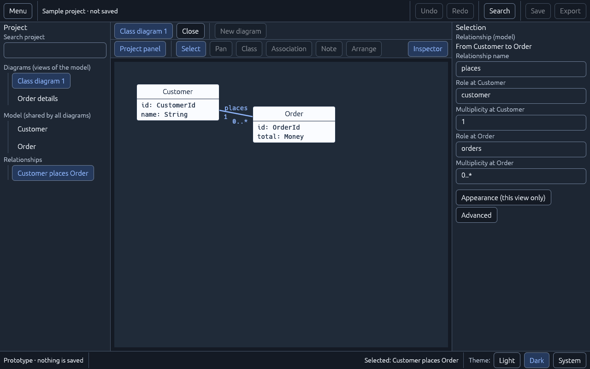 | 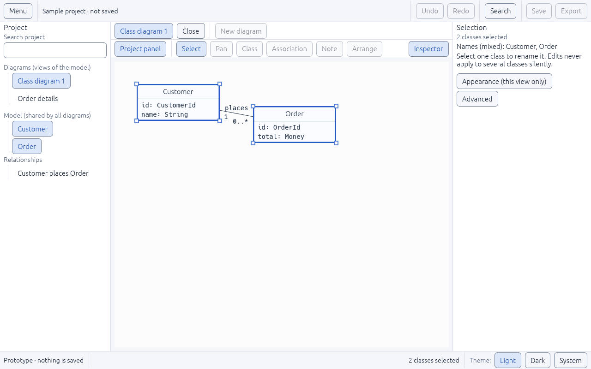 | 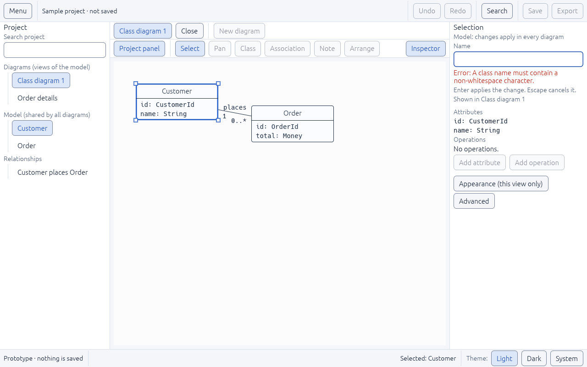 |

### UI-11 — Notation contract
- One table now says what each diagram type offers: its tools, inspector sections, allowed relationships, and how its canvas behaves. The tool row, the inspector and the new-project form all read it.
- Only **Class diagram** can be created today. Flowchart and Use Case (M4), and Entity-relationship and Sequence (M5), are described for planning but never offered. Sequence diagrams keep their own written rules (messages ordered top to bottom, aligned lifelines), so they won't be forced into the free-form class canvas.
- 8 new automated tests.

### Slice S2 — `shell.rs` split (no behaviour change)

The entry screens, tab row and canvas now live in `ui/entry.rs`, `ui/tabs.rs` and `ui/canvas.rs`. The real window was checked on Windows at 800×500, 1280×800 and 1440×900, light and dark, by launching `diagram-desktop` and driving it with the mouse and keyboard. Screenshots are in [p0-split-shell](p0-split-shell/): Welcome, New project, Escape back to Welcome, the sample workspace and a selected class. Known and unchanged from `main`: the relationship line and its labels are faint on the dark canvas, because the document ink does not follow the theme.

### Slice S3 — the window reads the real document

The project panel, canvas and inspector now read a `diagram-core` document through `ui/read_model.rs`; rename and association edits are commands, Undo and Redo follow the history, and File > Close project asks first when work would be lost. Checked in the real Windows window by mouse and keyboard: Welcome, sample project, select a class, rename it (the canvas, panel and relationship change together), Undo and Redo with their status sentences, Menu > File > Close project, the dialog (Cancel has focus, Escape cancels and focus returns to Menu, Discard returns to Welcome), at 1280×800 light and dark and the dialog at 800×500. Screenshots: [p1-session-binding](p1-session-binding/). The headless audit covers the dialog at 1280×800 and 800×500. Notes: `0..*` is shown as `*` (the core's form); the model has no relationship name, so the old name field is gone.

## What is next
The order is set in [BUILD-PROGRAM.md](../next-steps/BUILD-PROGRAM.md):
1. **S10 storage core:** finish the review and merge it.
2. **B1 bug slice:** readable relationship lines on the dark canvas, "1 class shown", and Ctrl+Y for Redo.
3. **S4 to S9:** member parser, Class tool, member editing, canvas gestures, drag and connect, reuse and delete.
4. **S11, S12 and S13:** Save and Open in the window, pan, zoom and SVG export, then the keyboard journey and the final acceptance test.
5. **In parallel (needs a Windows desktop):** the R0-04 text and accessibility matrix (Arabic and mixed text, IME, Narrator/NVDA, 100/150/200% scaling), then the R0-05 framework decision.

## How to try it
From `app/`:

```sh
cargo run -p diagram-desktop --locked
```

Click a class or a name in the Model list, rename it in the inspector, press Ctrl+K to search commands and classes, and switch Light / Dark / System in the bottom-right corner. Run all checks with `scripts/check.ps1` on Windows, or the commands in the [workspace README](../../README.md).
