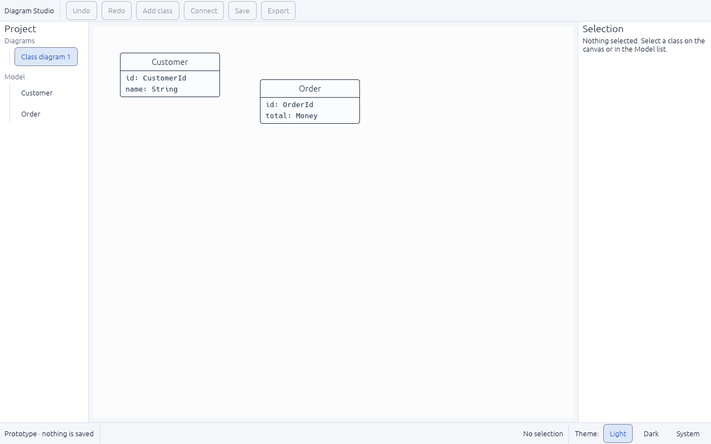
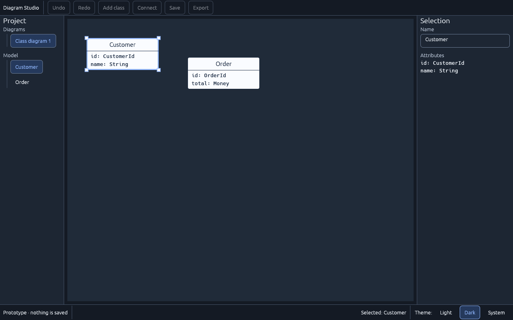

# UI-01 — Design tokens and base components

Status: **in progress** (2026-11-05). Done: tokens, controls, measured contrast, live theme switching. **Remaining** for the tracker definition: a component showcase fixture and checks of focus, error and disabled states. Plan: [UI-DESIGN-AND-INTEGRATION.md §3](../../../plan-rust-diagram-editor/UI-DESIGN-AND-INTEGRATION.md).

## What was built

- `crates/diagram-desktop/src/ui/theme.rs`:
  - Semantic tokens for light and dark (`Palette`): workspace, panel, canvas, text, secondary text, accent, text-on-accent, separator, **control border**, hover fill, selection fill, selected text, warning and danger.
  - The tokens are mapped onto egui's visuals, with spacing (8-unit rhythm, 4-unit gaps), 34-point control height, 32-point minimum row height, 6-point control radius and 8-point dialog radius.
  - `contrast_ratio` implements the WCAG formula, and `contrast_pairs` lists every pair the shell draws.
- `crates/diagram-desktop/src/ui/components.rs` holds the reusable widgets: panel title, field label, labeled text field (the label becomes its accessible name), list row, action button (a disabled button always explains why), warning text ("Warning:" prefix, never colour alone), segmented choice and truncating text.
- The shell uses only these tokens and components. Light is the default. A **Theme: Light / Dark / System** choice in the status bar switches immediately, without restarting. It will move into the Settings dialog in UI-09.
- Diagram objects keep fixed document colours, so a theme change never recolours a diagram. Hover and selection are editor overlays drawn in the accent colour.
- The tab component moved to UI-05, where the diagram tab row first uses it. UI-05's deliverable already includes diagram tabs.

## Measured contrast

The control-border colour in the original plan measured only 1.2–2.3:1. A second candidate, `#8A97AB`, also failed at 2.6–3.0:1. The chosen values are `#76839A` (light) and `#6E7F98` (dark). The separator colour stays for decorative lines only.

| Pair | Light | Dark | Minimum |
|---|---|---|---|
| Text on workspace / panel / canvas | 14.4 / 15.6 / 15.2 | 15.5 / 13.5 / 12.7 | 4.5 |
| Text on hover / selection | 13.5 / 12.5 | 11.3 / 10.3 | 4.5 |
| Secondary text on workspace / panel / hover | 5.9 / 6.4 / 5.5 | 9.7 / 8.5 / 7.1 | 4.5 |
| Accent on panel / workspace | 6.2 / 5.7 | 7.6 / 8.7 | 4.5 |
| Accent overlay on canvas | 6.0 | 7.2 | 3.0 |
| Text on accent | 6.2 | 8.7 | 4.5 |
| Selected text on selection | 6.1 | 5.8 | 4.5 |
| Focus ring on panel | 7.6 | 7.6 | 3.0 |
| Warning on panel / workspace | 6.8 / 6.3 | 10.6 / 12.2 | 4.5 |
| Danger on panel / workspace | 6.6 / 6.1 | 9.0 / 10.3 | 4.5 |
| **Control border** on panel / workspace / hover | 3.8 / 3.5 / 3.3 | 3.7 / 4.3 / 3.1 | 3.0 |
| Separator on panel (decorative, exempt) | 1.3 | 2.0 | none |

Disabled controls are faded by egui and are exempt under WCAG. Their contrast is checked with the other interaction states in UI-10.

## Verification

| Check | Result |
|---|---|
| `tests/theme.rs` (8 tests) | Pass: contrast formula, every light and dark pair, border stronger than separator, styles use the tokens, light default, Dark ↔ Light switching live, System follows the OS |
| Existing `tests/shell.rs` (11 tests) and `tests/diagnostics.rs` (8 tests) | Pass unchanged |
| `cargo fmt`, `cargo clippy --all-targets -D warnings` | Clean |
| Real window (Linux, virtual display) | Light start, class selected, switched to Dark live: [light](ui-01-light.png), [dark](ui-01-dark.png) |

## Not covered here
- Windows screenshots of both themes are collected at the UI-12 review.
- Hover, pressed and disabled-state contrast, and screen-reader checks, are UI-10.
