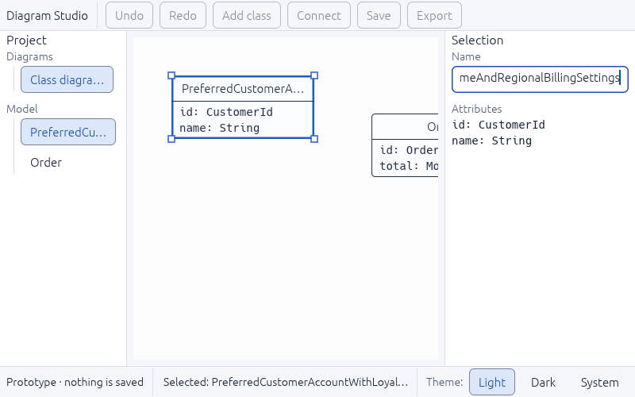

# UI-02 — Type scale and text roles

Status: **in progress** (2026-11-05). Done: text roles, sizes, direction rules, long-text handling. **Remaining** for the tracker definition: reviewed font files with versions and notices, fallback order, and multilingual typography fixtures (these feed R0-04). Plan: [UI-DESIGN-AND-INTEGRATION.md §3](../../../plan-rust-diagram-editor/UI-DESIGN-AND-INTEGRATION.md).

## What was built

- `TextRole` in `crates/diagram-desktop/src/ui/theme.rs` is the one place text sizes are defined. The theme maps each role onto an egui text style for both light and dark:

| Role | Size | egui style | Used for |
|---|---|---|---|
| Page title | 24 | `page-title` | Welcome screen heading (UI-04) |
| Panel title | 16 | Heading | "Project", "Selection" |
| Body | 15 | Body | Messages, list content, class names on the canvas |
| Label | 14 | Button | Field and section labels, buttons, status bar |
| Code | 14, monospace | Monospace | Attributes and other member lines |

- Components use roles, never sizes: `page_title`, `panel_title`, `field_label`, `code_text`, `truncated_text`. The canvas paints with `TextRole::font_id()`.
- Text-direction rules are written into the plan (§3). The right-to-left and mixed-text display rules are marked **open** until R0-04 records the bidi result.

## Problems found and fixed

Checking long names at 800×500 in the real window found two defects, both now fixed and covered by tests:

1. **List rows wrapped onto two lines.** "Class diagram 1" broke in the narrow sidebar, and a long class name grew to an 80-point, three-line row that spilled past the sidebar. Rows now stay on one line with an ellipsis.
2. **Long class names spilled out of their box on the canvas.** Painted text is now shortened to fit the box. Whether boxes should instead grow with their name is decided with the canvas states in UI-07.

The status bar was already shortening correctly. A test confirms that screen readers still receive the **full** text of shortened labels, rows and canvas boxes.

## Verification

| Check | Result |
|---|---|
| `tests/typography.rs` (9 tests) | Pass: role sizes, both theme styles carry every role, shell renders with the role sizes, no chrome overlap or overflow at 800×500 / 1280×800 / 1440×900, long name keeps controls inside the window, full name kept in the accessibility tree, list rows stay one line, painted canvas text fits its box |
| Regression check | With the row fix removed, the one-line test fails (row 80 points tall, past the sidebar); with it restored, it passes |
| All workspace tests | 47 integration + 1 doc test pass; `cargo fmt` and `clippy -D warnings` clean |
| Real window, 800×500, long name typed | Sidebar row, status and canvas box all shortened; field scrolls ([screenshot](ui-02-800x500-long-name.png)) |

## Not covered here
- 100/150/200% Windows scaling of the whole workspace is in UI-03's acceptance.
- Arabic and mixed-text display, and the bundled font files, belong to R0-04.
