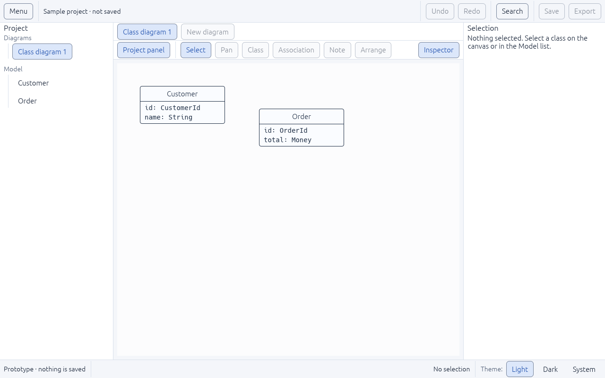
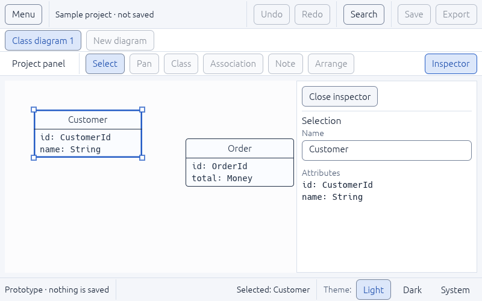
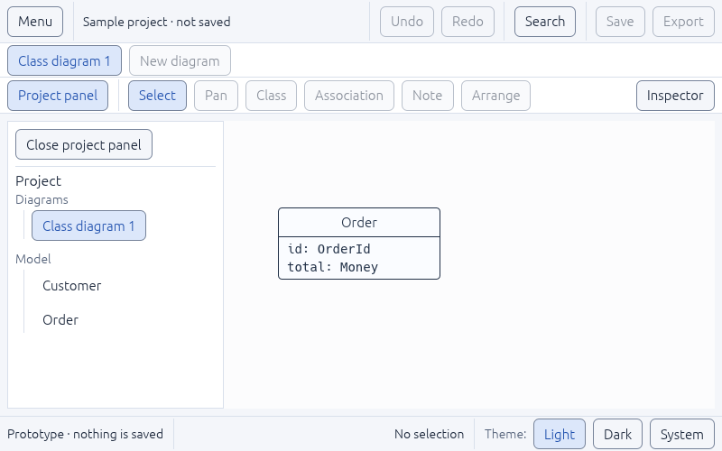
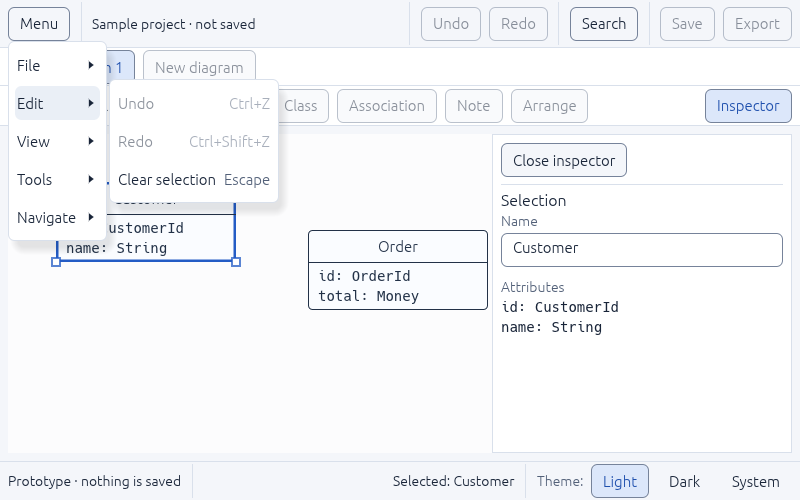

# UI-03 — Responsive workspace composition

Status: **in progress** (2026-11-05). The implementation and every acceptance check are complete; the tracker keeps it in progress until its prerequisite **UI-01** is done (component showcase and state checks). Plan: [UI-DESIGN-AND-INTEGRATION.md §1, §3, §4](../../../plan-rust-diagram-editor/UI-DESIGN-AND-INTEGRATION.md).

## What was built

- **Header (48):** a **Menu** button, the project name ("Sample project · not saved"), then Undo, Redo, Search, Save and Export.
  - The menu lists every command from the command catalog in File, Edit, View, Tools and Navigate submenus, with shortcuts. Unavailable items explain why on hover.
- **Centre column**, as in the plan's wireframe:
  - **Tab row (38):** the open diagram and **New diagram**. Tab overflow, closing and per-tab state are UI-05.
  - **Tool row (40):** a **Project panel** button, the tools Select, Pan, Class, Association, Note and Arrange, and an **Inspector** button. Select is the active tool; the others are disabled with reasons.
  - The canvas below.
- **Side panels** (`ui/workspace.rs`):
  - The project panel is 240 wide (resizable 180–360) and the inspector 300 (240–420).
  - They **dock** when the window can still give the canvas at least 480 points, which means 1020 points or wider.
  - On narrower windows they become **drawers** over the canvas only: one at a time, opened by the panel buttons, the menu or the search.
  - A drawer closes with its **Close** button, its panel button or **Escape**, and **focus returns to the button that opened it**.
- **Retained panel preferences:** hiding a docked panel is remembered while the window changes size, and panel widths are kept. Keeping these across restarts needs the preferences store, which waits for its serialization dependency (plan §10).
- The new commands (tools, New diagram, the two panel buttons) are in the catalog, so the header, rows, menu and search cannot disagree.

## Problems found and fixed

1. **Escape did nothing useful when a button had keyboard focus.** The shortcut code used egui's "wants keyboard input", which is true for *any* focused widget. So a keyboard user's Escape only removed focus from the button; it did not close the drawer or clear the selection. It now checks for a focused **text field** (`text_edit_focused`). Two tests fail without this fix and pass with it.
2. **Unpressed toggles looked like plain text.** The Project panel and Inspector buttons, and the Dark/System choices, had no border when not selected. They now keep the control border (measured at 3.1–4.3:1 in UI-01).

## Decision to review

**Status row height.** The plan says 30, but its controls (the theme choice) are 34 high to meet the 32-point minimum hit target. The row sizes to its controls, about 38. When the status bar gets its final content in UI-09, either keep this or move the theme choice into Settings and use the 30-point row for text only.

## Verification

| Check | Result |
|---|---|
| `tests/workspace.rs` (15 tests) | Pass: dock threshold (1020), drawer width, row order (header, tabs, tools, canvas), docked panels at 1280×800, no panels and full-width canvas at 800×500, inspector drawer covers only the canvas, one drawer at a time, Close button and toggle close it, Escape closes it and focus returns to its button, Escape in a drawer's text field first leaves the field, renaming in the drawer updates the canvas, a hidden panel stays hidden after a narrow phase, growing the window closes a drawer, the menu lists every group and runs commands, Escape on a focused button clears the selection |
| `tests/typography.rs` | All 15 header and row controls plus the status bar fit without overlap at 800×500, 1280×800 and 1440×900; long names checked inside the drawers on narrow windows |
| `tests/commands.rs` | Placements (header, tool row, tab row, panel buttons) and the five menu groups come from the catalog |
| All workspace tests | 79 integration + 1 doc test pass; `cargo fmt`, `clippy -D warnings` and `cargo doc` clean |
| Real window (Linux, virtual display) | Screenshots below |

| Docked, 1280×800 | Narrow, 800×500, inspector drawer |
|---|---|
|  |  |

| Narrow, project panel drawer | Menu with submenus and shortcuts |
|---|---|
|  |  |

## Not covered here
- Windows 100/150/200% scaling of this layout is part of R0-04 and the UI-12 review.
- Panel preferences that survive a restart need the preferences store.
