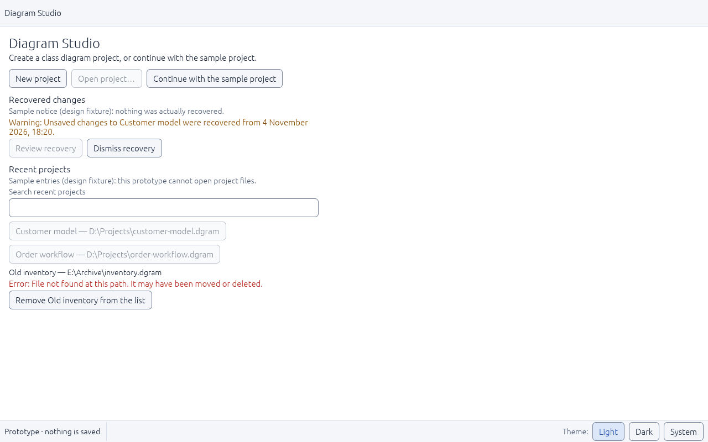
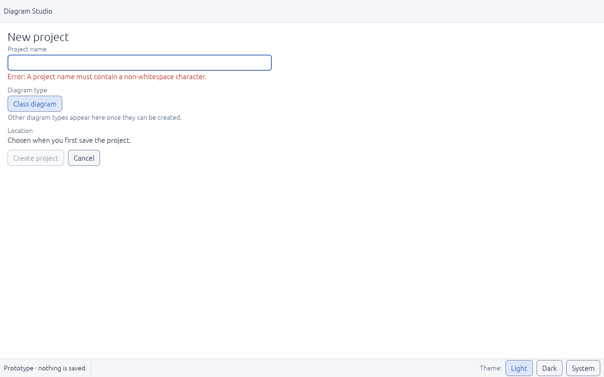
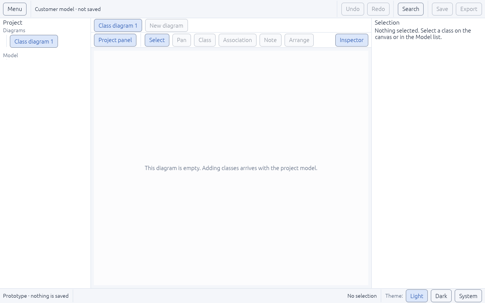

# UI-04 — Welcome and project entry screens

Status: **done** (2026-11-05). Plan: [UI-DESIGN-AND-INTEGRATION.md §4](../../../plan-rust-diagram-editor/UI-DESIGN-AND-INTEGRATION.md) (Welcome, New project).

## What was built

- **The app now starts on the welcome screen** (`ui/welcome.rs`):
  - **New project** works.
  - **Open project…** is disabled: *"Not available yet: opening project files arrives with project storage."*
  - **Continue with the sample project** opens the two-class sample.
- **Recovery notice**, labeled *"Sample notice (design fixture): nothing was actually recovered."* **Review recovery** is disabled with its reason; **Dismiss recovery** hides the notice.
- **Recent projects**, labeled *"Sample entries (design fixture): this prototype cannot open project files."*
  - A search field matches name or path, with distinct "No recent projects match …" and "No recent projects yet." messages.
  - Available entries are disabled with the storage reason, so nothing pretends to open a file.
  - The **missing-path** entry shows *"Error: File not found at this path. It may have been moved or deleted."* with **Remove … from the list**.
- **New project form:**
  - **Project name** is validated by the core rule (`diagram_core::ProjectName`). An **invalid name** shows the error beside the field, as a red border plus an "Error:" message, once you start typing.
  - **Diagram type** offers only implemented types, which is Class diagram today.
  - The **location** is chosen at first save.
  - **Create project** (or Enter) is disabled until the name is valid. It opens an empty diagram with the name exactly as typed, spaces included, and the header shows "‹name› · not saved".
  - **Cancel** (or Escape, after Escape has first left the field) returns to the welcome screen with focus on **New project**.
- An empty diagram shows *"This diagram is empty. Adding classes arrives with the project model."*

## Problems found and fixed

1. **The app would have crashed on start.** The theme installs its text styles during the first frame, after egui has already created that frame's UI with the default styles. The welcome screen is the first to use the 24-point page-title style, which was missing, and egui panics on a missing style. The current frame's UI now receives the new style too. Every welcome test failed without the fix.
2. **The name field lost keyboard focus as soon as its error appeared.** Typing a space showed the error, and everything typed afterwards was lost. The error variant wrapped the field in a new scope, which gave it a different id. It now changes the border in place. A test types after the error appears; it fails without the fix and passes with it. This also fixes the error field in the component showcase.
3. **The recovery notice was not labeled as a fixture.** It read like a real recovery, so it now carries the fixture label.
4. **The status bar showed "No selection" on the welcome screen.** The selection text now appears only in the workspace.

## Verification

| Check | Result |
|---|---|
| `tests/welcome.rs` (17 tests) | Pass: name rule from the core, recent search by name or path, app starts on the welcome screen, sample entries and notice labeled as fixtures, nothing pretends to open files, missing file explained and removable, search filters with a no-match message, recovery dismissible, form focuses the name and offers only Class diagram, blank name shows the error beside the field, Create opens an empty diagram with the exact name, Enter creates, Cancel returns focus to New project, Escape leaves the field then cancels, Continue opens the sample, controls fit at 800×500, typing continues after the error appears |
| All workspace tests | 103 integration + 1 doc test pass; `cargo fmt`, `clippy -D warnings` and `cargo doc` clean |
| Release binary (Linux, virtual display) | Starts on the welcome screen without a crash; New project → blank name error → typed "Customer model" → Enter → empty diagram |

| Welcome | Invalid name | Created project |
|---|---|---|
|  |  |  |

## Not covered here
- Real Open, Save, recent files and recovery arrive with project storage (M1) and are bound in UI-13 and UI-16.
- The project panel shows nothing under "Model" for an empty project. Its empty and no-match states belong to UI-05.
