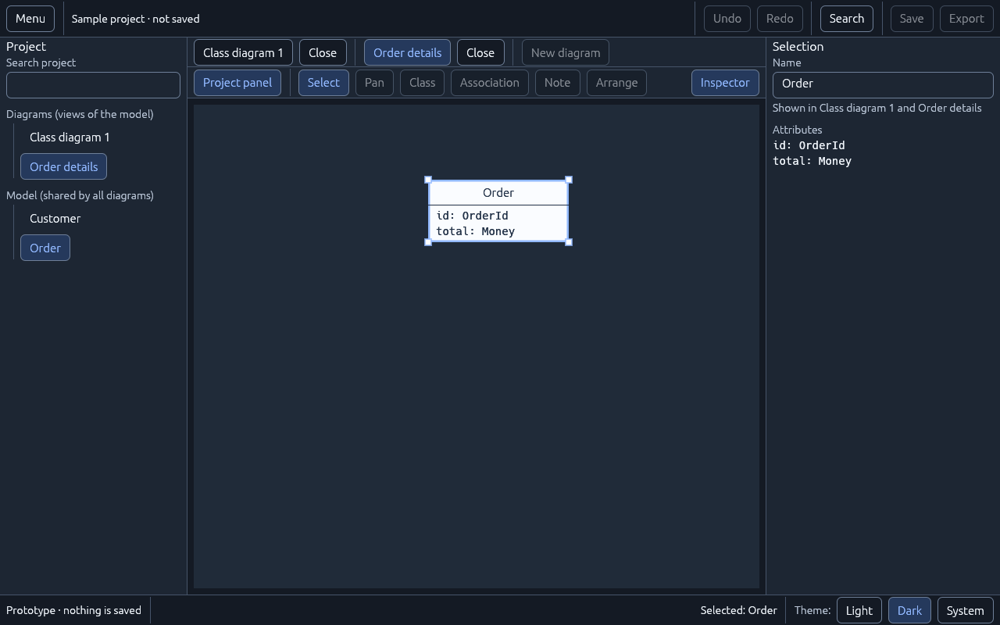
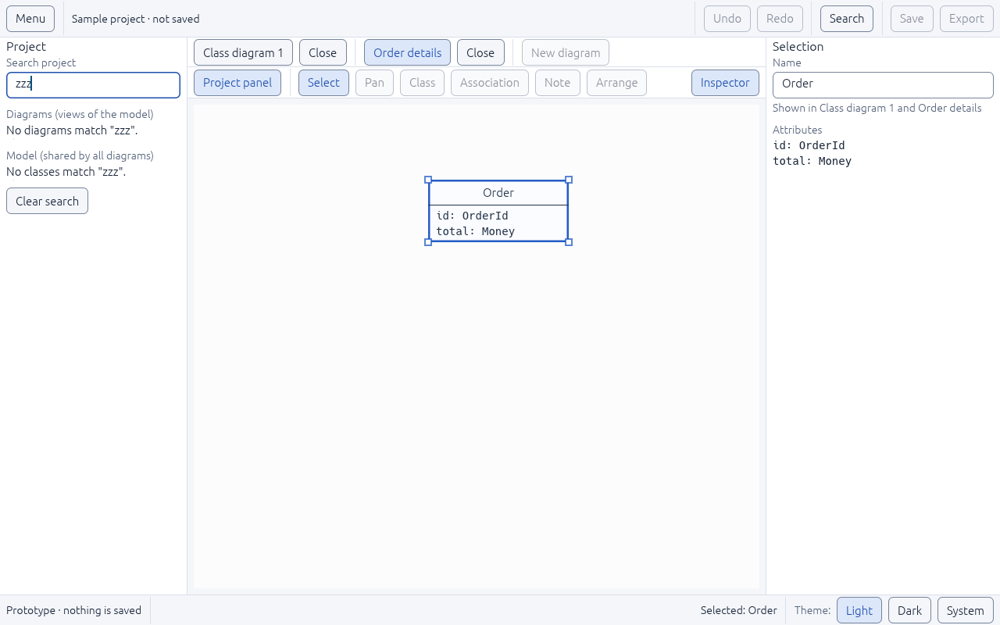

# UI-05 — Project panel (navigator) and diagram tabs

Status: **done** (2026-11-05). Plan: [UI-DESIGN-AND-INTEGRATION.md §4](../../../plan-rust-diagram-editor/UI-DESIGN-AND-INTEGRATION.md) (Navigator, Diagram tabs). Follows [UI-RULES.md](../../../plan-rust-diagram-editor/UI-RULES.md).

## What was built

- **Sample project with two diagrams:** "Class diagram 1" shows Customer and Order; "Order details" shows only Order. One model class appears in two diagrams, which is the model-versus-view case this task reviews. The diagrams are labeled prototype fixtures; real diagrams and sessions are UI-13.
- **Project panel** (`ui/navigator.rs` and the shell):
  - A **Search project** field filters both lists, ignoring case. **Clear search** appears while searching.
  - **Diagrams (views of the model):** selecting one opens it in a tab, or switches to its tab.
  - **Model (shared by all diagrams):** each class row's hover text says which diagrams show it, for example "Shown in Class diagram 1 and Order details".
  - **Reveal:** selecting a class that the current diagram does not show opens a diagram that shows it and selects it there.
  - **Distinct states:** "No diagrams yet.", "No classes yet. Classes appear here when you add them to a diagram.", and "No diagrams match "…"." / "No classes match "…"."
- **Inspector wording:** under the name, "Shown in …" makes clear that renaming changes the class in every diagram.
- **Diagram tabs:**
  - One tab per open diagram, exposed to assistive technology with the **Tab** role and selected state.
  - Each tab has a labeled **Close** button (accessible name "Close ‹diagram›"). Closing a tab never removes classes from the project.
  - **Each tab keeps its own selection**, which comes back when you return to the tab.
  - Tabs that do not fit go into a **More tabs (n)** menu; the active tab always stays visible.
  - With no tab open, the canvas says "No diagram is open. Open one from the project panel."
- **Keyboard:** rows and tabs are buttons, so Tab reaches them and Enter opens a diagram. The overflow menu works with the keyboard as well.

## Decisions

- **Both sections are always visible** instead of a Diagrams/Model switch. Short lists are easier to scan together, and the existing search covers longer ones. Revisit if real projects have many diagrams.
- **"New diagram" appears only in the tab row.** A second copy in the project panel gave screen readers two identical buttons, so it was removed.
- **No per-tab unsaved marker:** unsaved state is project-wide and shown in the header ("· not saved"), as the plan specifies.

## Verification

| Check | Result |
|---|---|
| `tests/navigator.rs` (15 tests) | Pass: search matching, "shown in" wording, which tabs fit (order kept, active always visible), panel lists both sections with view wording, tabs have the Tab role and a named Close, opening adds a tab showing only its classes, per-tab selection restored, closing never removes model elements, reveal opens the right diagram, search filters both lists with no-match messages and Clear search, empty project message, inspector "Shown in", Enter opens a diagram, overflow menu with eight tabs at 800×500 |
| `tests/ui_audit.rs` | New scenes pass: project panel with no matches, eight overflowing tabs at 800×500 and 1280×800 (names, sizes, overlaps, Tab reachability) |
| All workspace tests | 127 integration + 1 doc test pass; `cargo fmt`, `clippy -D warnings` and `cargo doc` clean |
| Real window (Linux) | Opened Order details from the panel, selected Order, dark theme; search with no matches |

| Two tabs, dark theme | Search with no matches |
|---|---|
|  |  |

## Not covered here
- Rename and duplicate for diagrams need the project model (M1) and are bound in UI-13.
- Screen-reader announcement of tab changes is checked with Narrator/NVDA in UI-10.
