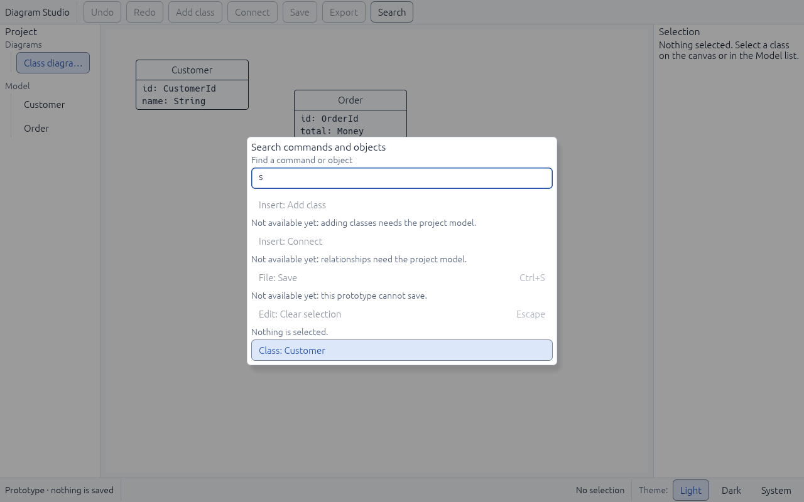

# UI-06 — Tool and command catalog

Status: **done** (2026-11-05). One catalog for header, tool row, tab row, menu, search and shortcuts; typed UI intents; a contract for every action.

## What was built

- **`ui/commands.rs`, one catalog of every command.** Each entry has a label, menu group, shortcut, whether a text field owns its keys, and whether it appears in the toolbar. `availability()` returns *enabled* or *disabled with a reason*.

| Command | Group | Shortcut | Text field keeps the keys | Today |
|---|---|---|---|---|
| Undo | Edit | Ctrl+Z | Yes | Disabled: needs the project history |
| Redo | Edit | Ctrl+Shift+Z (also Ctrl+Y) | Yes | Disabled: needs the project history |
| Add class | Insert | — | — | Disabled: needs the project model |
| Connect | Insert | — | — | Disabled: needs the project model |
| Save | File | Ctrl+S | No | Disabled: this prototype cannot save |
| Export | File | — | — | Disabled: SVG export is planned for v0.1 |
| Search | Navigate | Ctrl+K | No | Enabled |
| Clear selection | Edit | Escape | Yes | Enabled when something is selected |

- **Every surface reads from the catalog:**
  - The **toolbar** is built from `toolbar()`.
  - **Menus** come from `menu_groups()`. No menus exist yet; the UI-03 header must render them from this, which is now part of UI-03's acceptance.
  - The **command search** uses `search()`.
  - **Shortcuts** go through `take_shortcut()`.
- **Shortcut rules:**
  - The more specific shortcut wins, so Ctrl+Shift+Z is never read as Ctrl+Z.
  - When a text field had focus in the previous frame, keys the field uses (Ctrl+Z, Ctrl+Shift+Z, Ctrl+Y, Escape) stay with the field.
  - A command may have a second, unshown shortcut for a platform convention: Redo also answers Ctrl+Y. No key combination belongs to two commands.
  - Ctrl+K and Ctrl+S still work while typing.
- **Command and object search (`ui/palette.rs`)**, opened with Ctrl+K or the toolbar **Search** button:
  - Results are labeled "Group: Command" or "Class: Name" and show their shortcut. Unavailable commands show their reason under the row.
  - Arrow keys move the highlight, which starts on the first result that can actually run. Enter runs it, which can select a class.
  - Escape or a click outside closes the search, and focus returns to where it was.
  - This is the first version of the plan's command palette surface.

## Typed intents and action contracts (completion)

- **`ui/intents.rs`, typed intents.** Widgets never change state directly. They queue a `UiIntent`: `Run { command, origin }`, `SelectClass`, `RevealClass`, `OpenDiagram`, `ActivateTab`, `CloseTab`, `SetTheme`, `CloseDrawer` or `CloseShowcase`. One coordinator in the shell (`apply_intents`) applies the queue in order after the frame is drawn. `Run` checks availability, and `origin` is the control that focus returns to when a drawer or window it opened closes. Text fields are the exception: they edit a draft in place, and committing drafts as model commands is UI-14.
- **`commands::contract`, one contract per command:** prerequisite, effect, effect owner (editor / project model / worker), undo policy, and the test that covers its current behaviour. A test fails if a contract names a test that doesn't exist (proven by pointing one at a missing name), and another proves no project-model or worker command is available yet.

| Command | Prerequisite | Owner | Undo |
|---|---|---|---|
| Undo / Redo | A change in the project history (M1) | Project model | Moves history |
| Search | None | Editor | Not recorded |
| Save | Project storage and a file (M1) | Worker | No project change |
| Export | SVG export (M3) | Worker | No project change |
| Select | None | Editor | Not recorded |
| Pan | Canvas scrolling and zoom (UI-07) | Editor | Not recorded |
| Class, Association, Note, New diagram | The project model (M1) | Project model | One step |
| Arrange | Movable objects (M2) | Project model | One step |
| Project panel, Inspector | None | Editor | Not recorded |
| Clear selection | Something is selected | Editor | Not recorded |
| Component showcase | None | Editor | Not recorded |

- **Improvement found while routing intents:** choosing a class in the command search now *reveals* it, opening a diagram that shows it, instead of selecting a class that might not be on the current diagram.

## Problems found and fixed

1. **Focus did not return after closing the search.** egui keeps a closed dialog's layer on top for one more frame, and a text field behind a dialog gives up focus. Focus is now returned once the dialog layer has cleared. This rule is added to the plan for every future dialog (UI-09).
2. **Enter did nothing for common searches.** The highlight started on the first result even when it was unavailable; typing "s" highlighted "Add class". It now starts on the first available result. The test fails without this fix and passes with it.

## Verification

| Check | Result |
|---|---|
| `tests/commands.rs` (22 tests) | Pass: catalog order and uniqueness, every disabled command has a reason, Clear selection needs a selection, toolbar and menu groups come from the catalog, search by label or group, search results and labels, highlight bounds, first available result, toolbar matches availability, unavailable shortcuts change nothing, Ctrl+K and the Search button open the search, type + Enter selects, arrows move the highlight, unavailable results show their reason and stay open, Escape closes and keeps the selection and restores focus to the Name field; every command has a contract naming an existing test; model and worker commands stay unavailable; queued intents apply after the frame; queued unavailable commands change nothing; a class chosen in search is revealed |
| `tests/typography.rs` | Updated: the new Search button fits without overlap at 800×500, 1280×800 and 1440×900 |
| All workspace tests | 64 integration + 1 doc test pass; `cargo fmt`, `clippy -D warnings` and `cargo doc` clean |
| Real window (Linux, virtual display) | Ctrl+K opens the search; "s" lists unavailable commands with reasons and highlights "Class: Customer"; it fits at 800×500 ([screenshot](ui-06-command-search.png)) |

## Not covered here
- Header menus are drawn in UI-03, from `menu_groups()`.
- Screen-reader announcements of the search results are checked with real Narrator/NVDA in UI-10.
