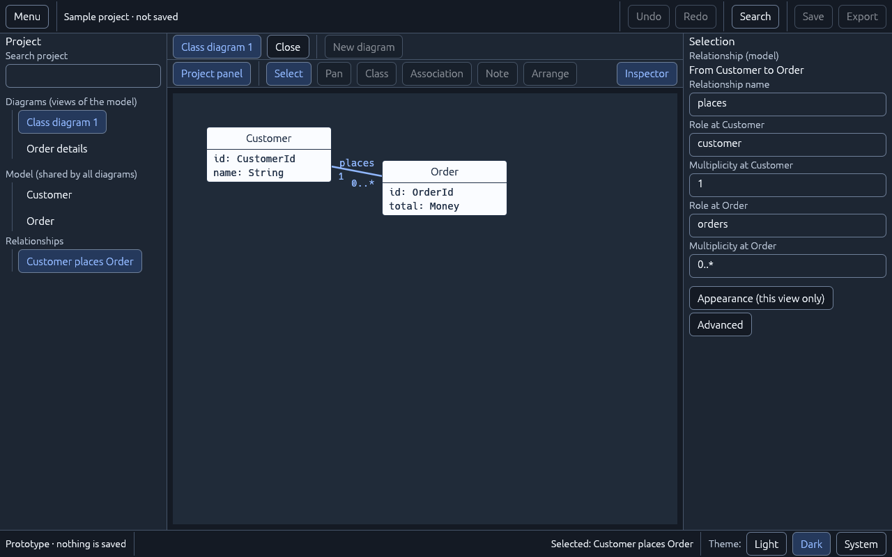
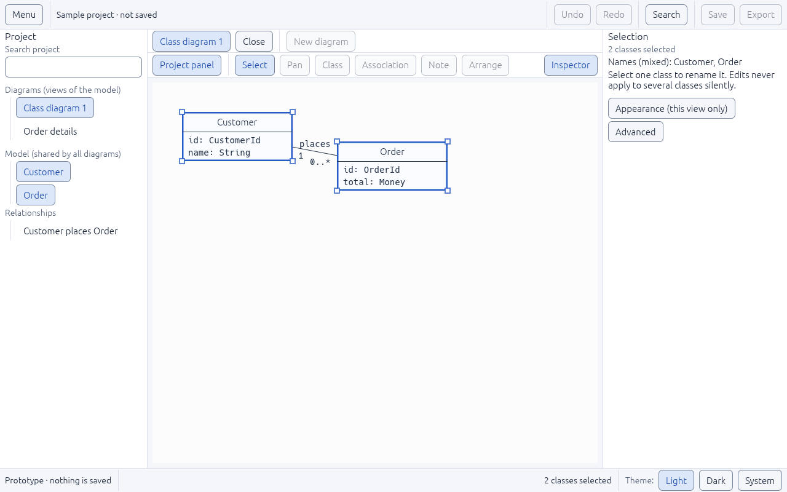
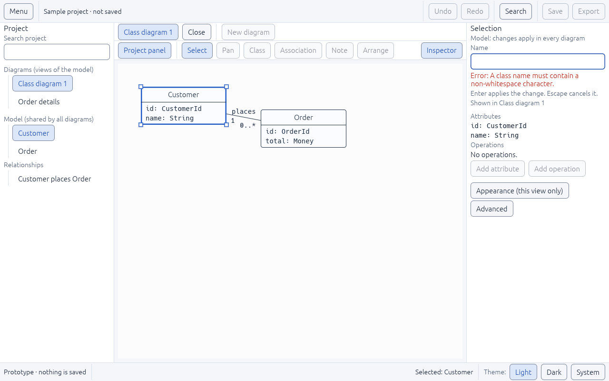

# UI-08 — Contextual inspector

Status: **done** (2026-11-05). Plan: [UI-DESIGN-AND-INTEGRATION.md §4–§5](../../../plan-rust-diagram-editor/UI-DESIGN-AND-INTEGRATION.md) (Inspector, Members, Rename). Follows [UI-RULES.md](../../../plan-rust-diagram-editor/UI-RULES.md).

## What was built

- **Explicit commit and cancel rules (drafts).** Every inspector field edits a **draft** kept in `ShellState::drafts`, never the class or relationship itself.
  - **Enter**, or moving focus away (Tab or a click elsewhere), commits a valid draft as a typed intent (`RenameClass`, `SetRelationField`). The coordinator validates it again before changing the record.
  - **Escape** cancels the draft and restores the committed value. A second Escape then continues as usual (closes a drawer, clears the selection).
  - An **invalid draft stays editable with its error** beside the field and is never committed. While editing, the field shows "Enter applies the change. Escape cancels it."
- **Four contexts:**
  - **Nothing selected:** the diagram's name and how many classes it shows, plus the Ctrl+click tip.
  - **One class:**
    - A **Model** section ("changes apply in every diagram") with the name draft, which diagrams show it, and members: attributes, operations, and **Add attribute / Add operation** disabled with the reason "members need the project model".
    - **Appearance (this view only)** and **Advanced**, collapsed by default, opened with labeled toggle buttons. Appearance editing is disabled with its reason.
  - **Several classes (mixed values):** "2 classes selected", "Names (mixed): Customer, Order", and *"Select one class to rename it. Edits never apply to several classes silently."* There is no name field, so a mixed edit can't happen by accident. Appearance shows "Mixed".
  - **A relationship:** "From Customer to Order", with drafts for the relationship name and each end's **role** and **multiplicity**. Multiplicities are validated: `1`, `*`, `0..1`, `1..*` and `2..5` are accepted; `5..2`, `0..0`, `1..` and text are rejected.
- **Multi-selection:** Ctrl+click on the canvas or in the Model list adds or removes a class. Ctrl+Enter does the same from the keyboard on a focused row. A plain click selects only that class.
- **Relationships in the sample:** Customer *places* Order (1 to 0..\*). It is listed under **Relationships** in the project panel and drawn on the canvas, with its name above the line and multiplicities below it near each end. The status bar shows "Selected: Customer places Order" or "2 classes selected".

## Problems found and fixed

1. **The name field wrote the class directly on every keystroke**, which breaks this task's acceptance rule ("no widget writes authoritative document records directly"). It is now a draft committed through an intent.
2. **"→" is not in egui's default font.** "Customer → Order" would have drawn an empty box on systems without a fallback font; the inspector now says "From Customer to Order". A search found no other such symbols in the UI.
3. **Relationship labels collided** on short lines ("places", "1" and "0..\*" on top of each other). The name now sits above the line and the multiplicities below.
4. **The usability audit could not see scrolling.** Content scrolled out of a drawer was reported as overlapping the status bar. Scroll regions are now named, clipping `ScrollView` nodes in the accessibility tree, which also tells screen readers the region scrolls. The audit only counts the visible part of scrolled content.
5. **Two sections shared the label "Model (shared by all diagrams)"** (project panel and inspector). The inspector now says "Model: changes apply in every diagram".

## Verification

| Check | Result |
|---|---|
| `tests/inspector.rs` (14 tests) | Pass: multiplicity rule, relation field values and errors, no-selection details, name stays a draft until Enter (canvas unchanged), Escape cancels and restores, Tab commits, invalid draft keeps its error and never commits, members and disabled Add buttons, Appearance/Advanced collapsed then opened, relationship endpoints from the project panel, invalid multiplicity rejected and a valid one committed, Ctrl+click builds and shrinks a mixed selection with no name field, Ctrl+click on the canvas, a plain click replaces a mixed selection |
| `tests/ui_audit.rs` | New scenes pass at 1280×800 and 800×500: relationship inspector, mixed selection, invalid draft with every section open |
| All workspace tests | 147 integration + 1 doc test pass; `cargo fmt`, `clippy -D warnings` and `cargo doc` clean |
| Real window (Linux) | Relationship selected (dark), mixed selection, invalid name draft |

| Relationship (dark) | Mixed selection | Invalid draft |
|---|---|---|
|  |  |  |

## Not covered here
- Real member editing, appearance styles and committing through project commands with undo are M1/M2, bound in UI-14.
- Selecting a relationship by clicking its line on the canvas belongs to the canvas states (UI-07).
