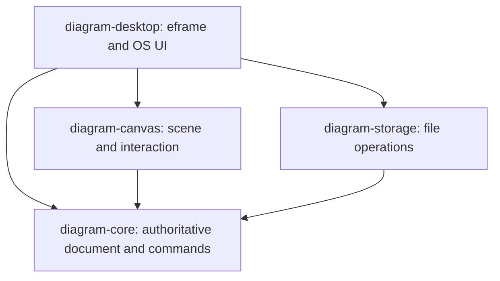

# 02 — Rust architecture

## Four-crate workspace

Proposed future source layout; this planning pass does not create a Cargo workspace:

```text
D:\REA visual\
  app\
    Cargo.toml                   workspace and shared dependencies
    Cargo.lock                   committed for reproducible application builds
    rust-toolchain.toml          exact tested toolchain
    crates\
      diagram-core\src\         typed IDs, models, views, commands, validation, history
      diagram-canvas\src\       geometry, picking, interactions, scene and SVG export
      diagram-storage\src\      SQLite, snapshots, versioning and migrations
      diagram-desktop\src\      eframe shell, inspectors, palette and OS integration
    tests\fixtures\             small reference projects and expected invariants
    assets\                     original icons, licensed fonts and notices
    docs\                       development/run instructions
  plan-rust-diagram-editor\      this implementation plan
  research\                     preserved VP observations
```

Dependency direction:



`core` must not import egui, SQLite or OS APIs. `canvas` must not own the document or write files. `storage` must not interpret pointer gestures. Desktop owns orchestration and the active document. Initial notation definitions are ordinary Rust modules, not dynamically loaded plugins or a generic scripting platform.

## Authoritative state

```text
Project { project_id, schema_version, elements, relations, diagrams }
Element { element_id, parent_id?, name, kind: ElementKind }
ElementKind::Class { ordered_attribute_ids, ordered_operation_ids, flags }
Attribute { member_id, owner_id, name, type_text, visibility, multiplicity }
Operation { member_id, owner_id, name, parameters, return_type, visibility }
Relation { relation_id, kind, source_element_id, target_element_id, ends }
Diagram { diagram_id, notation_id, name, node_views, edge_views }
NodeView { view_id, element_id?, parent_view_id?, bounds, style, presentation }
EdgeView { view_id, relation_id?, source_anchor, target_anchor, route, labels }
Anchor { node_view_id, member_id?, attachment: SideAndRatio | Auto }
```

Use typed UUID newtypes so a ViewId cannot accidentally substitute for an ElementId. Model kinds use Rust enums with typed data. Keep future extension fields limited and schema-validated; do not make every property an untyped JSON map.

World geometry is finite `f64` in logical units, with checked conversion to renderer coordinates. Width/height must be positive, zoom is bounded, and screen-to-world transforms have explicit inverses. Semantic containment and visual grouping are separate. Keep viewport, selection, hover, active tool and inline-edit drafts in editor state, outside semantic state. Viewport/workspace preferences can be saved separately without marking the semantic document modified.

## Commands and history

Examples: CreateClass, AddMember, RenameElement, ConnectAssociation, AddGeneralization, MoveViews, ResizeView, ChangeStyle, ShowElementInDiagram, RemoveView, DeleteModel, RenameDiagram.

1. Input produces an intent, not direct model mutation.
2. Validate notation, references and constraints; compute a reversible patch against the current revision.
3. Apply the entire patch atomically; on failure apply none of it.
4. Store forward/inverse patch plus affected IDs; increment document revision.
5. Invalidate only affected geometry/layout/cache entries and update dirty state.

Dragging uses transient preview state; pointer release commits one MoveViews command. Escape, capture loss or cancellation discards the preview. Inline typing commits once on Enter/focus completion according to the documented focus policy, not once per character. One undo reverses one user action. Undo is meaningful even for compound node/model/relationship creation.

Initial history budget: 500 complete transactions or 64 MiB of estimated retained patches, whichever comes first. Evict whole oldest transactions, never part of an inverse. Surface history limits; undo/redo memory is not part of the saved project.

## Canvas and notation boundary

The canvas interaction state machine includes Idle, Pan, Marquee, MovePreview, ResizePreview, ConnectPreview and InlineTextEdit. Input has explicit priority: modal/native dialog → focused text editor → active tool → canvas shortcuts. Global Delete/Undo must not steal ordinary text-editor keys.

Notation definitions provide supported tools, typed element/relation checks, node measurement/layout, endpoint/containment rules, property sections and export semantics. Start with class notation. Reuse primitives for flowcharts; provide a dedicated sequence strategy later.

Build a renderer-neutral scene of shapes, polylines, arrowheads, text runs and hit regions from model/view state. Cache text measurement and scene data by revision/style/font inputs. Recompute affected incident edges after movement. Keep semantic relations valid even when a view or route is absent.

Drawing and SVG export consume the same scene description. Sharing the scene does not guarantee identical font metrics across applications; test SVG with the selected redistributable font and record any fallback differences. Begin with escaped SVG text and a documented font dependency; do not promise universal pixel equality or embedded glyph outlines in v0.1.

## Persistence contract

One proposed `.dgram` SQLite file per project. Separate schema tables for metadata, elements, members, relations, diagrams, node views and edge views; foreign keys for identity/ownership. Version typed payloads and encode geometry in explicit fields or validated JSON where appropriate. Enable foreign keys on each connection. Our schema is independent of VP's database/payload grammar.

The UI owns state. A bounded background worker owns the SQLite connection and processes load/save/export jobs. Save takes an immutable snapshot tagged with revision R and validates it before a transaction. On success acknowledge exactly R; if the user has edited to R+1, the document remains dirty. Serialize jobs per target, coalesce superseded pending snapshots and reject stale load results.

For an existing database use an all-or-nothing SQLite transaction, preserving the prior committed state on errors. Initial file creation/Save As writes a sibling temporary database, closes it and validates it before publishing with a tested Windows replacement routine. Do not use remove-then-rename. Preserve the old destination if replacement fails. Explicit Save As replacement follows a normal overwrite prompt. Pick SQLite journaling/checkpoint policy during M1 fault tests; never copy a live database without its journal/WAL state.

Autosave is a separate recoverable snapshot, proposed every 30 seconds after dirty activity; it never silently overwrites the last explicit save. Offer recovery with timestamp/source on restart. Back up before schema migrations, migrate transactionally, and reject newer unsupported schemas read-only rather than rewriting them. Reject invalid references/coordinates and bound file/payload sizes before allocating large objects.

## Work and thread ownership

Keep UI event processing and drawing on the UI thread. Use a standard worker thread plus bounded channels for initial I/O/export; no async runtime is necessary for an offline app. Workers return owned results; UI applies results at a defined boundary. Use cancellation tokens for optional tasks and graceful shutdown for an in-flight save. Keep logs in per-user app data and omit full project content.
