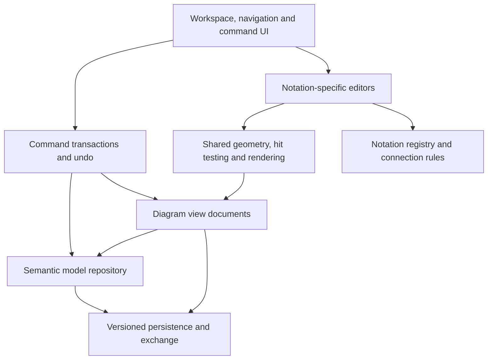

# Diagramming product: implementation planning backlog

This is a proposal based on the installation/API survey, three directly exercised editor families, newly saved project data and successful XML export. It is not a claim that VP's private implementation has been recovered.

## Architectural decision

Build one project/model repository and one canvas foundation. Add a registry for notation schemas, palette items, connection rules, renderers, property editors and specialized interactions. Keep commands, persistence, diagnostics and exchange independent of the UI framework.

## Build sequence and exit conditions

| Stage | Scope | Exit condition |
|---|---|---|
| 1. Project foundation | Stable IDs, model/view hierarchy, relationships, typed properties, commands, undo/redo, native persistence | Same model can have two independent views; edits and saves preserve identity |
| 2. Workspace UI | Diagram/model browser, tabs, breadcrumb, palette, inspector, selection synchronization, command search | A new user can create, find and edit a diagram without implementation knowledge |
| 3. Class vertical slice | Classes/members, association ends, generalization, geometry, routing, inline/specification editing | Customer/Order fixture works, with tested compound undo and save/reopen |
| 4. Shared editor quality | Snapping, guides, alignment, distribution, style, grouping, layers, copy-view/copy-model, layout, export | Cross-cutting behaviors have declared semantics and deterministic verification |
| 5. Behavioral UML | Use-case, activity, state and sequence strategies | Valid relations, containment, temporal order and visual notation preserved per family |
| 6. ER + requirements/SysML | Tables/columns/keys/indexes, cardinality, blocks/ports, requirement links | Structured properties drive appearance; relations validate against notation rules |
| 7. Remaining family adapters | General visuals, matrices/tables, specialized architecture/business/UI/document editors | Each accepted family has schema, renderer, tool palette, rules and fixtures |
| 8. Exchange and services | Fixture-based XML adapters, additional exports, optional extensions and collaboration | Compatibility has roundtrip evidence; external features have explicit scope |

Stages describe dependency order, not estimated calendar duration. Full scope and delivery estimates need agreed target diagram families, platform and fidelity.

## UI component backlog

| Component | Required behavior | Evidence status |
|---|---|---|
| Searchable creation wizard | Type search, descriptions, blank/template selection, metadata and location | Observed in three native types |
| Model tree | Semantic containment, icons, selection, locate references | Observed; reparenting semantics need tests |
| Project browser | Grouped thumbnails, model/files/recent tabs and search | Observed; advanced filtering untested |
| Palette registry | Tools depend on current notation and context | Observed differences in Class/Sequence/ER |
| Canvas input | Pointer state machine, text editing, drag/resize, multiselect and pan/zoom | Placement, dragging, movement tested; remainder pending |
| Connector tools | Type rules, routes, endpoint anchors, labels and reconnect | Association/message creation tested; API establishes richer representations |
| Contextual controls | Selection handles, contextual creation, context menu and shortcuts | Observed; full contextual catalog pending |
| Schema-based inspector | General/member/relationship fields, documentation, validation, Apply/Cancel | Class/attribute/entity dialogs observed |
| Sequence-specific editor | Lifelines, activations, messages, temporal order, fragments and numbering | Basic message/activation/numbering tested; advanced modes pending |
| ER-specific editor | Model level, tables/columns, PK/FK/index/constraint properties | Model-level switch and dialogs observed; mutations pending |
| Presentation editor | Font/fill/line, compartments, stereotypes, labels, layers | API and menu observed; formatting operations pending |
| Persistence/recovery UI | Dirty state, Save As, progress, diagnostics, safe recovery | Save and status observed; recovery/reopen pending |
| Export UI | Format, scope selection, options, preview, destination, progress/results | Simple XML export tested |

## Notation implementation contract

Every diagram family must declare:

1. Stable notation ID and display label.
2. Model types, typed properties and semantic relation kinds.
3. Permitted source/target and containment rules.
4. Default palette and contextual quick actions.
5. Node/edge/member/label renderers and export behavior.
6. Interaction strategy and geometry constraints.
7. Property specifications, validation messages and documentation fields.
8. Undo transaction boundaries and clipboard identity rules.
9. Persistence schema/versioning and migration behavior.
10. Small reference fixtures plus behavior and rendering acceptance criteria.

Use [DIAGRAM-CATALOG.md](DIAGRAM-CATALOG.md) and `ce-evidence/diagram-families.json` as the full 101-constant scope inventory. A shared constant is a candidate adapter, not an automatic commitment to implement it or proof CE enables it.

## Focused validation backlog

Prioritize gaps with architectural consequences:

- Paste View versus Paste Model and cross-project clipboard behavior.
- View removal versus semantic deletion and dependency cleanup.
- Master/auxiliary-view containment and package ownership.
- Association endpoint properties versus visual anchors and ports.
- Shape/member text metrics and connector-to-member targeting.
- Sequence message insertion/reordering, activation duration and fragment membership.
- ER primary/foreign-key propagation and database type changes.
- XML import/export fidelity for identities, references, geometry and embedded assets.
- Save/reopen, migration, failed writes and recovery.
- Keyboard interaction, focus, accessible names and screen-reader support.

## Broader-program planning boundary

Code/ORM tooling, report composition, business/enterprise methods, agile tools, AI generation, online diagram services and teamwork are separate functional areas. Their menu entrypoints were observed; their complete behavior has not been validated. Plan them as independent epics after the core modeling/editor workflows, rather than inferring full capability from ribbon buttons.

Before choosing a stack, settle desktop versus web, offline scope, supported OS, initial diagram families, required VP-file compatibility and desired fidelity. The research supports these decisions without requiring us to reuse Java, VP assets, or VP implementation code.
