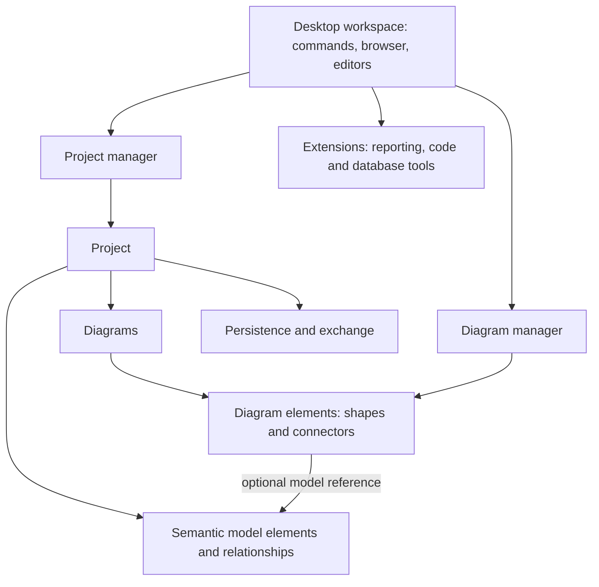

# Visual Paradigm CE 18.1: understanding and rebuild reference

Inspection date: 2026-11-04. Target: `C:\Program Files\Visual Paradigm CE 18.1`.

**Follow-up:** direct UI investigation has now succeeded. Read [UI-STUDY.md](UI-STUDY.md), [the screenshot gallery](UI-GALLERY.html), [the full diagram catalog](DIAGRAM-CATALOG.md), and [the planning backlog](PLANNING-BACKLOG.md). The initial startup limitation below is historical. Three native editors were exercised, a new project was saved, and selected diagrams were exported to XML; this does not establish full feature parity.

This is the completed initial architecture survey. It establishes the product's purpose, installed structure, public object model, and a sampled project database. It does not claim complete behavioral equivalence or a complete reconstruction of the implementation.

## 1. What the program is

Visual Paradigm Community Edition is a visual modeling environment for describing software, systems, and database designs. Its central output is an editable project containing structured model elements and diagrams. A useful example is a software class: the class has a name, attributes, operations, and relationships; its diagram view has position, size, colors, and compartment visibility.

The vendor describes CE as supporting UML, requirements, ER diagrams, and other diagramming categories. Some categories on its website involve online tools; the marketing catalog is broader than the locally verified desktop behavior. [CE overview](https://www.visual-paradigm.com/editions/community/).

The important engineering consequence is that a faithful independent product needs both a **semantic model repository** and a **diagram editor**. Drawing rectangles and arrows alone does not provide model reuse, cross-diagram consistency, structured properties, or reliable project exchange.

## 2. Exact target and evidence boundaries

The supplied Start Menu folder contains a shortcut named `Visual Paradigm 18.1.lnk`, which resolves to:

```text
C:\Program Files\Visual Paradigm CE 18.1\bin\Visual Paradigm.exe
Working directory: C:\Program Files\Visual Paradigm CE 18.1\bin
Arguments: none
```

There is also a separate installation at `C:\Program Files\Visual Paradigm 18.1`. Earlier evidence for that installation is retained in `evidence/`; the authoritative evidence for this request is in **`ce-evidence/`**.

| Observation | Evidence | Confidence / limit |
|---|---|---|
| Installed release 18.1, build 20261101 | `resources/vpupdateinfo.xml` | Confirmed local metadata |
| Four inspected Windows launchers are AMD64 PE executables | PE machine field `0x8664` | Confirmed; executable hashes recorded |
| Java 11.0.16.1 is bundled | `jre/release` | Confirmed; not the system Java version |
| Desktop UI exposes Swing/AWT types | `ViewManager`, `DiagramManager` public signatures | Confirmed API surface; not a UI trace |
| 2,114 files, 1,077,424,731 bytes at scan time | Recursive inventory | Includes runtime, resources, integrations, installer files |
| 101 diagram-type constants | Installed `IDiagramTypeConstants` | Shared platform surface, not 101 enabled CE editors |
| Bundled `.vpp` sample uses SQLite | Header and read-only schema queries | Confirmed for this sample only |
| Interactive startup initially could not be inspected; later session accessible | Initial launch failed; follow-up UI investigation succeeded | Class/Sequence/ER basic workflows now observed; see UI-STUDY.md |

The file `product_edition.properties` has an empty `edition` value. Therefore the directory/shortcut identify the installed CE distribution, but this properties file alone cannot verify the active runtime entitlement.

## 3. CE scope versus shared platform scope

The vendor's edition table lists these CE capabilities: UML diagrams; SysML diagrams; ER modeling; flowcharts; image/PDF export; project XML exchange; and multiple views of one model element. It does not mark BPMN, C4, DFD, or XMI exchange as CE features. Some collaboration features require a service. [Edition comparison](https://www.visual-paradigm.com/support/edition-comparison.jsp).

The installed API contains BPMN, ArchiMate, C4, wireframe, planning, and other types. Their presence shows shared distribution breadth; it does not establish that the CE UI enables them. Similarly, a batch file's presence does not prove it succeeds under CE. Initial rebuild scope should focus on locally verifiable CE modeling workflows, with broader platform features treated as later scope.

## 4. Installed directory structure

| Directory | Observed contents | Architectural meaning |
|---|---|---|
| `bin/` | Main, update, product-selector, shape-editor launchers; Windows helpers | Native startup and OS integration |
| `jre/` | Java runtime, JavaFX modules, native runtime libraries | Self-contained Java execution environment |
| `lib/` | 19 JAR files, about 453 MB | Application platform and dependencies |
| `bundled/` | `project.xsd`, API JAR, model images, third-party notices | Exchange schema and developer resources |
| `resources/` | Project sample, templates, schemas, packaged web/server resources | Data-driven assets and supporting content |
| `shapes/` | Shape configuration and packages | Shape definitions/resources; loading behavior not traced |
| `ormlib/` | ORM and related optional dependencies | Database/code tooling dependencies |
| `scripts/` | 27 batch/build files | Automation entrypoints |
| `sde/`, `integration/` | IDE-specific adapters and integration assets | External development-tool integration |
| `UserLanguage/` | Language resources | Localization support |
| `.install4j/`, `uninstaller/` | Installer configuration and runtime | Packaging and installation lifecycle |

The shipped `scripts/VisualParadigm.bat` starts the bundled JVM, builds a classpath, and invokes class `RV`. That is the observed batch-launch path; the native EXE startup sequence has not been traced instruction by instruction. The script also lists some numbered JARs absent from this installation, so it is a generic launcher rather than a precise module inventory.

## 5. Library map

The following are archive-entry observations, not assertions that every dependency executes during ordinary editing:

| Archive | Observed packages / classes | Interpretation |
|---|---|---|
| `vpplatform.jar` | 36,515 class entries; many short `v/...` names | Large platform bundle; precise subsystem mapping unresolved |
| `lib01.jar` | 66,053 class entries; many short names | Large opaque application bundle; counts are not feature counts |
| `openapi.jar` | 2,445 classes under `com.vp.plugin` | Public extension/object-model API |
| `lib02.jar` | Batik, POI, XMLBeans, EMF, JIDE, Guava, API packages | SVG, document/XML, UI and utility support inferred from package identities |
| `lib03.jar` | Apache FOP | Document rendering support inferred |
| `lib04.jar` | PlantUML, Jersey, Grizzly, Jackson, PDF-related packages | Text-diagram, web/serialization and document capabilities inferred |
| `lib05.jar` | `org.sqlite` | SQLite integration support |
| `lib06.jar` | JxBrowser | Embedded browser capability |
| `lib07.jar` | JxCapture/JxDesktop | Desktop/capture capability |
| `lib09.jar` | No `.class` entries | Resource/native payload; not classified further |
| `jniwrap.jar`, `winpack.jar` | JNIWrapper / Windows packages | Native interoperability |
| `vpserver.jar`, `vpserverres.jar` | Server, command, document packages | Server/supporting resources; no service was started or traced |

Many internal class names are short and non-descriptive, consistent with obfuscation. This reduces the value of identifying features by private class names. Public interfaces, file schemas, and controlled behavior are better anchors for the rebuild specification.

## 6. Public object model and subsystem boundaries

`ApplicationManager.instance()` is the public entry point. Its exposed managers include project, diagram, action, view, documentation, reporting, resource, database, and code synchronization managers. This is a map of the API's service boundaries, not proof of the original implementation's exact layering.



Key installed interfaces:

- `IProject`: model and diagram containment, lookup, project-related state.
- `IModelElement`: semantic identity/properties and access to diagram appearances.
- `IRelationship`: semantic relationship abstraction.
- `IDiagramUIModel`: diagram/view container.
- `IDiagramElement`: common visual element abstraction.
- `IShapeUIModel`: geometry and shape presentation.
- `IConnectorUIModel`: routes, points, endpoint pins, connector presentation.
- `IModelElementFactory`: typed construction of model objects.

`DiagramManager.createDiagramElement(diagram, model)` explicitly connects a model with a visual view. Connector creation accepts a model, endpoint views, and route points. Layout APIs expose orthogonal, hierarchical, circular, organic, tree, and label layout options; the underlying algorithms and their implementation are not established here.

The vendor API documentation explicitly permits multiple diagram views of a single model element. [IModelElement API](https://www.visual-paradigm.com/support/documents/pluginjavadoc/com/vp/plugin/model/IModelElement.html).

Example interpretation: rename the semantic class `Customer` and all its views should display the updated name; move its view in diagram A and diagram B should retain its own geometry. This is a required design invariant for our proposed implementation, not a behavior experimentally exercised in this session.

## 7. Project storage: a confirmed sample

The bundled file `resources/BaggageSchemas.vpp` begins with `SQLite format 3`. It opened read-only through SQLite and passed `PRAGMA quick_check`.

| Table | Rows | Structural role indicated by schema |
|---|---:|---|
| `PROJECT_INFO` | 1 | Project identity, version/build, root references, definition payload |
| `MODEL_ELEMENT` | 899 | IDs, type, hierarchy, name, author/timestamps, definition payload |
| `DIAGRAM` | 18 | Diagram type/name, parent model, definition payload |
| `DIAGRAM_ELEMENT` | 96 | Diagram ownership, optional model reference, parent view, definition payload |
| `PROJECT_FILE` | 82 | Embedded path/content entries |
| `USER_ID_FORMAT` | 7 | Identifier formatting settings |
| `TW_HISTORY` | 0 | History-shaped metadata; runtime semantics unverified |
| `sqlite_sequence` | 0 | SQLite bookkeeping |

`DIAGRAM_ELEMENT.MODEL_ELEMENT_ID` is nullable and references `MODEL_ELEMENT.ID`. This supports model-backed views while allowing other visual entries. `PARENT_ID` supports visual containment. `MODEL_ELEMENT.PARENT_ID` provides separate semantic containment. Relationship endpoint encoding is not fully decoded from the payloads.

Definitions are stored as BLOBs. The outer relational schema is understood; the complete inner definition grammar is **not**. The sample has 899 model rows, but many are configuration/style objects; this is not a count of 899 user-facing business entities. No repeated model references were found in this sample's diagram elements, so multi-view behavior is established through the API/documentation rather than demonstrated by this particular data set.

The bundled sample may originate from an earlier project version. A later controlled UI save confirmed that the new CE 18.1 research project is also SQLite; see `ce-evidence/ui-project-inspection.json`. Native `.vpp` compatibility still requires payload and roundtrip validation before implementation.

## 8. XML exchange and automation

`bundled/project.xsd` defines a project export structure with separate `ProjectInfo`, `Models`, and `Diagrams` sections. It provides a useful reference for semantic versus presentation separation. It is a shipped schema, whose current exporter conformance still needs testing.

Batch entrypoints include XML/XMI/BPMN import/export, diagram-image export, Excel exchange, code generation/reverse engineering, ORM operations, project validation/statistics, and teamwork operations. `ExportXML.bat` invokes `com.vp.cmd.ExportXML`; `VisualParadigm.bat` invokes `RV`.

These are discovered interfaces, not successful runtime tests. Some scripts include legacy JVM flags, and CE entitlements differ. For interoperability research, first test CE's documented project XML exchange on a disposable project instead of writing directly to a `.vpp` database.

## 9. Initial unknowns and follow-up status

This list records gaps from the first static pass. The subsequent UI study resolves basic workspace, creation, class connection/movement/undo, sequence message creation, ER property UI, save format and selected XML export. Advanced workflows remain open; use UI-STUDY.md for the current coverage ledger.

- Exact visible workspace and menu arrangement in this CE installation.
- Creation, selection, resizing, connection, alignment, and inline-edit gestures.
- Undo grouping, redo, clipboard identity rules, and delete-from-view versus delete-model behavior.
- Sequence numbering, lifeline layout, combined fragments, and specialized notation constraints.
- Current save format, definition grammar, migrations, recovery, and attachment serialization.
- Which API/automation operations actually run under this CE distribution.
- Rendering/layout performance and large-project behavior.
- Plugin lifecycle, internal event ordering, collaboration protocol, and synchronization rules.

Launching the CE EXE through computer-use did not expose a targetable window. No account setup, license changes, or configuration changes were attempted to get past startup. This limits the survey to installation evidence, public API structure, the bundled sample, and official documentation.

## 10. Rebuild direction

Build an independently implemented modeling application around stable model IDs, separate visual views, explicit relationships, a notation registry, and transactional editing. Use original code and assets. The original Java packaging is evidence about VP, not a requirement for our technology choices.

Start with a complete vertical workflow: create project → create class diagram → add classes and association → edit properties → reuse a class in another diagram → undo/redo → save/reopen → export. Then expand the same engine into use-case, activity, sequence, ER, and requirements diagrams.

See [REBUILD-SPEC.md](REBUILD-SPEC.md) for proposed modules, data structures, acceptance criteria, and the remaining behavior-capture plan.

## Reproducing the inspection

```powershell
python "D:\REA visual\research\visual-paradigm\inspect_installation.py" --root "C:\Program Files\Visual Paradigm CE 18.1" --out "D:\REA visual\research\visual-paradigm\ce-evidence"
```

The script reads installed files and archive indexes and queries the bundled database in read-only mode. It writes metadata into the specified evidence directory; it does not extract application implementation code. Public API signature listings were produced separately with the system JDK's `javap`, without bytecode disassembly.
