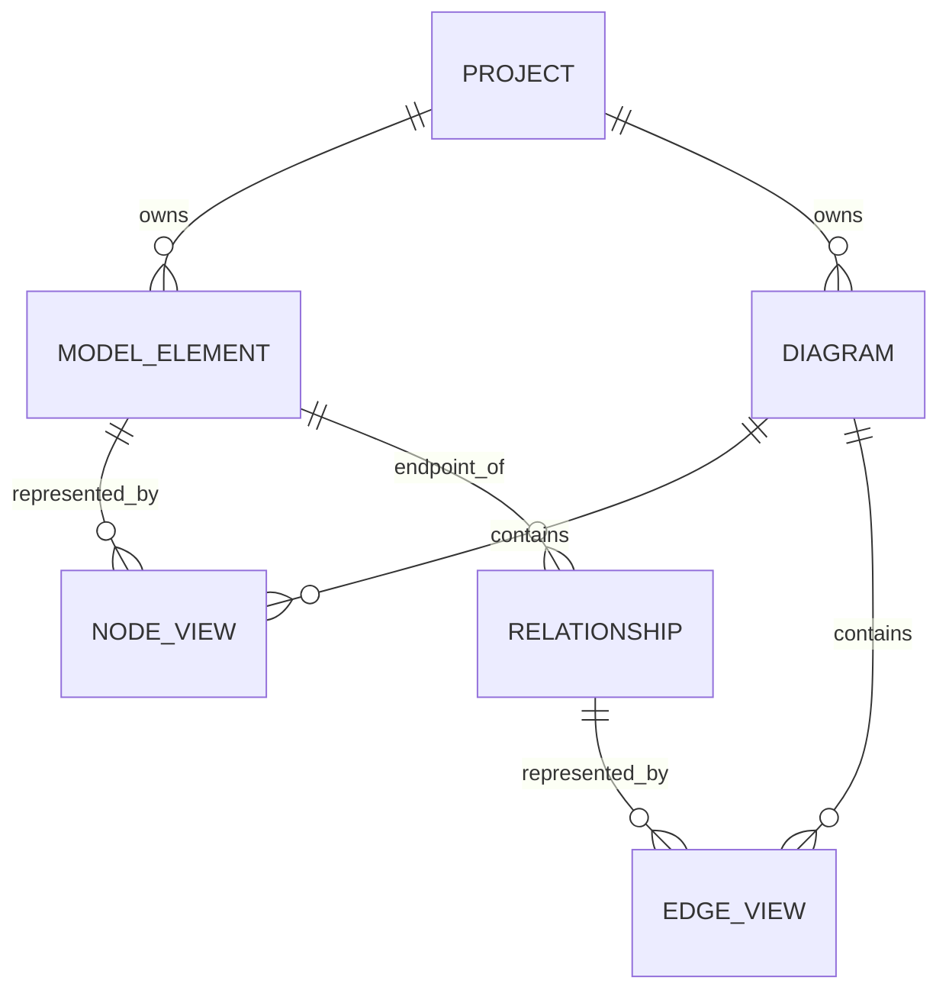

# Independent modeling application: proposed rebuild specification

Status: design proposal derived from the initial CE architecture survey. This is not a description of recovered Visual Paradigm source code. No application implementation has been started.

## Product foundation

Provide a project workspace where users create structured models, display them in multiple diagrams, edit properties, navigate relationships, save their work, and export diagrams. Preserve the distinction between the meaning of an object and the appearance of each occurrence.

## Proposed modules

| Module | Responsibility |
|---|---|
| Workspace shell | Project opening, diagram tabs, model tree, command surfaces, properties editor, search |
| Model repository | Stable IDs, typed elements, relationship endpoints, semantic hierarchy and references |
| Notation registry | Allowed element types, connection rules, property schemas, renderers, default styles |
| Diagram document | View IDs, model references, geometry, routes, labels, visual containment, layers |
| Canvas and interaction | Hit testing, selection, pan/zoom, drag/resize, snapping, guides, connection handles |
| Command system | Transactions, undo/redo, document dirty state, change events |
| Persistence | Versioned schema, atomic saves, reopen, recovery, embedded assets |
| Import/export | Native project format, image export, later XML exchange adapters |
| Validation | Invalid endpoints, missing references, notation-specific constraints |
| Extension boundary | Optional generators, importers, validators and notations |

Start with a modular application in one process. The evidence does not justify introducing microservices or copying the original deployment layout. Choose the desktop/web framework after defining platform, distribution, and offline requirements.

## Proposed data model

```text
Project { id, schemaVersion, name, rootIds, diagrams, assets }
ModelElement { id, type, name, parentId?, properties, documentation }
Relationship { id, type, sourceModelId, targetModelId, properties }
Diagram { id, type, name, ownerModelId?, viewIds, viewport }
NodeView { id, diagramId, modelId?, parentViewId?, bounds, style, labels }
EdgeView { id, diagramId, relationshipId?, sourceViewId, targetViewId,
           routePoints, endpointAnchors, labels, style }
Asset { id, mediaType, contentHash, content }
```

This intentionally defines our own schema. It does not reproduce VP's BLOB grammar. Generic properties should be validated against registered type schemas rather than permitting arbitrary inconsistent values.



The diagram shows model-backed objects; free annotations can have no model reference. Concrete source/target endpoint fields are defined in the text schema above.

## Core invariants

1. Model identity survives save/reopen and view movement.
2. A semantic rename is visible in every view referencing that model.
3. Moving or styling one view does not overwrite another view's geometry/style.
4. Removing a view is a distinct operation from deleting the underlying model.
5. Removing a model handles dependent relationships and views deterministically.
6. Every edit goes through a command transaction and is reversible where applicable.
7. Creating a model, view, and connecting relationship can be one undo step.
8. Saves preserve referential integrity and never leave a half-written project on failure.
9. Zoom/pan changes viewport state, not model or shape coordinates.
10. Export derives from document geometry and style, not a screenshot of editor controls.

## Implementation sequence

### Milestone 1: class modeling vertical slice

- Project/model tree and diagram tabs.
- Class nodes with name, attributes and operations.
- Association and generalization, with correct endpoint semantics.
- Selection, drag, resize, pan/zoom, labels and property editing.
- Model reuse across two diagrams.
- Command transactions and undo/redo.
- Versioned native storage, save/reopen, SVG/PNG export.

Acceptance scenario: define Customer and Order; associate them; show Customer in a second diagram; rename Customer once; verify both names change; move only one view; save and reopen; verify IDs, routes, members, and view geometry remain intact; undo and redo one compound edit.

### Milestone 2: shared editor quality

Add snapping, alignment/distribution, connector routing, keyboard navigation, multi-selection, clipboard rules, search, style presets, validation, autosave/recovery, and export fidelity. Measure interaction on declared project sizes before setting performance targets.

### Milestone 3: notation expansion

Add use-case, activity, sequence, ER and requirement editors. Each should register notation-specific semantics rather than implement an unrelated canvas. Sequence diagrams need a dedicated interaction/layout strategy for lifelines, temporal ordering and messages. ER modeling needs keys, cardinality and column types.

### Milestone 4: interoperability and extensions

Investigate VP project XML exchange with fixture-based tests. Add `.vpp` reading only after validating current storage and complete required payloads. Consider broader enterprise/business notations, generators and collaboration only after the core workflows are stable and explicitly scoped.

## Behavior-capture plan before claiming parity

When the CE workspace is accessible, create a disposable project under this research directory and record the following experiments. These experiments remain unexecuted.

| Experiment | What to record |
|---|---|
| New project and class diagram | Default structure, menus, model IDs/types, generated files |
| Create class and members | Shape compartments, semantic properties, edit behavior |
| Show one class in two diagrams | Shared identity versus independent presentation |
| Rename, move, resize | Property scope and exact changed records |
| Create association/generalization | Endpoint representation, arrowheads, multiplicities |
| Delete visual occurrence | Whether model remains and how the UI explains it |
| Delete underlying model | Impact on dependent views and relations |
| Undo/redo creation and movement | Transaction granularity and dirty-state behavior |
| Copy/paste within/across diagrams | Reuse versus duplication of model identity |
| Save/reopen and XML export | Schema, serialization, IDs, geometry and version fields |
| Image export | Fonts, margins, backgrounds, vector fidelity |
| Sequence and ER workflows | Specialized constraints and interactions |

For persistence comparisons, save before/after fixtures, record hashes, inspect SQLite schema and record counts read-only, and compare XML structure. Preserve the originals. Do not edit VP's installed database or write speculative changes to its project payloads.

## Open decisions

Desktop-only versus browser availability; Windows-only versus cross-platform; first required diagram families; native VP compatibility requirements; offline expectations; accessibility targets; and whether collaboration is in the initial release. These do not block the initial structural survey, but they should be resolved before choosing the implementation stack.
